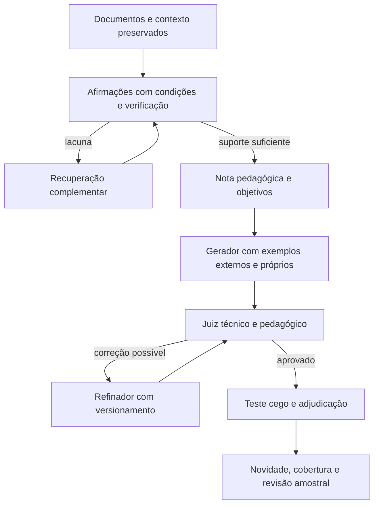

# Revisão da arquitetura de geração de QA com RAG

Pesquisa e inspeção local: 18/10/2026. Código e resultados de referência: `dev`, commit `6c13844`.

Atualização posterior à pesquisa: a implementação experimental está em `pipeline/qa_v11/`,
na branch `codex/qa-evidencias-verificadas`. Este documento registra a investigação que
fundamentou a mudança, não resultados de execução da arquitetura nova.

## 1. Diagnóstico e decisão recomendada

**O problema não está concentrado em um prompt. Estamos usando evidência documental heterogênea como matéria-prima de uma prova profissional, sem separar suficientemente três decisões: o que o texto afirma, o que podemos considerar conhecimento técnico sustentado e o que vale a pena avaliar.** Ao mesmo tempo, alguns bloqueios de implementação eliminam conteúdo aproveitável. Apertar o juiz aumenta o descarte; liberar o redator aumenta o risco de acrescentar explicações sem comprovação. Nenhum desses movimentos, sozinho, resolve a preparação do conhecimento.

Recomendo preservar notas técnicas, exemplos externos limpos, exemplos próprios, gerador, juiz, refinador e teste cego. A mudança é no contrato entre eles: evidências verificáveis primeiro; nota pedagógica elaborada sobre essas evidências; questões orientadas por competências; revisão capaz de distinguir falta de conhecimento, ambiguidade e defeito reparável.

Esta é uma proposta fundamentada, ainda sem demonstração experimental no nosso domínio. Não há evidência para prometer correção definitiva, nem para atribuir o problema a um deployment específico. O próximo teste precisa comparar alternativas com as mesmas entradas e avaliação humana independente.

### O que foi efetivamente examinado

- Artigos, apêndices e, quando disponíveis, prompts no código original dos métodos descritos abaixo. Links apontam para fontes primárias; os arquivos em `main` podem mudar.
- Coleta, extração, seleção, inventário, notas, complemento, geração, julgamento, refino e exemplos do repositório.
- Resultados do piloto v5/v10 e observações já fornecidas pelo especialista.
- Contagem automática de **52 arquivos de seleção**, com **10.247 ocorrências e 6.817 IDs de trechos distintos**, provenientes de quatro execuções. Leitura qualitativa de exemplos de diferentes coleções e das falhas do piloto. **Não foi feita leitura semântica dos 6.817 trechos.**

Os corpora brutos completos não estão disponíveis neste checkout. Assim, a inspeção das bases usa o código de aquisição/extração, a documentação original e os textos preservados nas seleções. Não se trata de auditoria integral dos PDFs, imagens ou de todo o corpus. O registro/API do Zenodo não pôde ser lido pelo navegador de pesquisa; a caracterização do REGIS foi confirmada no repositório dos autores. Os resultados estruturais são reproduzíveis por `inventariar_material.py` e estão em `inventario_material.json`.

## 2. O que os outros métodos fazem e o que aproveitar

### Ragas: cenários antes da redação

O Ragas transforma documentos em unidades com resumos, temas e relações. Seus sintetizadores recebem contexto, persona, estilo, extensão e termo/temas. Os prompts geram pergunta e resposta juntas e exigem sustentação no contexto, admitindo inferências. No sintetizador multihop há instrução de conectar pelo menos dois segmentos. O campo adicional de orientação guia o tipo de pergunta, sem autorizar fatos novos. [Transformações oficiais](https://github.com/vibrantlabsai/ragas/blob/main/src/ragas/testset/transforms/default.py), [prompt single-hop](https://github.com/vibrantlabsai/ragas/blob/main/src/ragas/testset/synthesizers/single_hop/prompts.py), [prompt multihop](https://github.com/vibrantlabsai/ragas/blob/main/src/ragas/testset/synthesizers/multi_hop/prompts.py).

**Aplicação proposta:** escolher a competência e as evidências antes de redigir; permitir variedade de apresentação. Não precisamos adotar um banco de grafos para começar: relações e dependências podem continuar em registros simples. A instrução de usar dois segmentos não comprova integração indispensável. O próprio exemplo do prompt multihop permite questionar quanto da resposta depende do primeiro segmento; precisamos testar atalhos.

### Auto-RAG-Eval: gerar não encerra a avaliação

O trabalho gera exames de múltipla escolha a partir de documentação por domínio. O apêndice A publica o prompt e os filtros de estrutura, autonomia e alternativas degeneradas. Depois compara sistemas com diferentes recuperadores e também sem recuperação ou com contexto ideal. Usa Teoria de Resposta ao Item para estudar dificuldade e informação das questões. [Artigo e apêndice A](https://arxiv.org/html/2405.13622v1), [implementação dos autores](https://github.com/amazon-science/auto-rag-eval).

**Aplicação proposta:** separar avaliação da recuperação e da geração; criar uma condição com evidência ideal para localizar o gargalo. Não transportar automaticamente os filtros de alternativas para nosso QA aberto, nem ajustar IRT a 11 questões e poucos respondentes. Regex de autonomia é apenas um filtro inicial: retirar o nome do documento não torna um resultado particular um princípio geral.

### RAFT: evidência ideal e documentos distratores

RAFT é uma receita de geração de dados para adaptar modelos a RAG, não um gerador de provas profissionais. No código, primeiro gera perguntas curtas respondíveis pelo trecho; depois produz respostas com justificativa e citações delimitadas. O registro conserva `oracle_context` separado do contexto com documentos distratores. [Artigo](https://arxiv.org/html/2403.10131v1), [código e prompts, funções `build_qa_messages`, `prompt_templates` e `generate_question_cot_answer`](https://github.com/ShishirPatil/gorilla/blob/main/raft/raft.py).

**Aplicação proposta:** preservar o conjunto exato de evidências que sustenta cada gabarito e testar resistência a material irrelevante. Não copiar a preferência por respostas de poucas palavras; nossos itens podem exigir explicação. A citação da resposta comprova atribuição ao documento, não a veracidade universal do documento.

### MultiHop-RAG: afirmações contextualizadas antes da combinação

O método extrai evidências de notícias, transforma-as em afirmações sem pronomes ambíguos, verifica alinhamento e identifica entidades/temas de conexão. Agrupa duas a quatro afirmações e gera perguntas de inferência, comparação, tempo ou informação insuficiente. O apêndice A publica os prompts; há avaliação automática e inspeção humana de uma parte dos itens. [Método e prompts](https://arxiv.org/html/2401.15391v1), [repositório original](https://github.com/yixuantt/MultiHop-RAG).

**Aplicação proposta:** desambiguar o objeto da afirmação, preservar o texto de origem e só combinar relações compatíveis. Não importar a restrição a respostas como sim/não, entidade ou marcador temporal. Alinhamento entre afirmação e notícia também não equivale à comprovação de um princípio técnico.

### AutoBencher: a referência mais próxima da autonomia que queremos

AutoBencher fornece informação privilegiada ao autor das questões, mas não ao modelo avaliado. O prompt de `gen_qa_pairs_augmented` pede perguntas respondíveis por um especialista sem o parágrafo original, evitando detalhes arbitrários do texto e subjetividade. A busca de categorias usa resultados anteriores para explorar lacunas. O artigo inclui verificação humana e limitações. [Artigo](https://arxiv.org/html/2407.08351v2), [prompt original em `wiki_autobencher.py`](https://github.com/XiangLi1999/AutoBencher/blob/main/wiki_autobencher.py).

**Aplicação proposta:** o documento verifica o gabarito; a pergunta avalia conhecimento transferível. Categorias e desempenho podem orientar cobertura, sem otimizar apenas para fazer um modelo errar. A recomendação de resposta curta do trabalho não é requisito pedagógico para nós. Relevância profissional deve vir do nosso escopo e do especialista, não de popularidade de páginas.

### MiRAGE: completar contexto técnico antes de gerar

O MiRAGE, de 2026, preserva estrutura e elementos visuais, expande contexto quando faltam definições/artefatos e distingue complemento que resolve a lacuna de material apenas relacionado. Publica prompts de completude, geração, verificação e deduplicação. O verificador também distingue questões que exigem o conteúdo das respondíveis por conhecimento geral. [Artigo, seções 3 e apêndice A](https://arxiv.org/html/2601.15487v1), [repositório dos autores](https://github.com/ChandanKSahu/MiRAGE).

**Aplicação proposta:** resolver lacunas concretas antes de escrever QA e rastrear quais partes da resposta dependem de cada evidência. **Não copiar seu objetivo de exigir o documento:** isso entraria em conflito com nossa prova de conhecimento profissional. Tampouco copiar a fusão automática de várias questões em uma pergunta abrangente: pode recriar nossos enunciados longos. É um preprint e não demonstra qualidade no domínio FPSO; a expansão também tem custo.

### ARES e Promptagator: exemplos e avaliação precisam ser específicos da tarefa

ARES usa exemplos de passagens, perguntas e respostas do domínio para gerar dados sintéticos, incluindo negativos. Distingue relevância do contexto, fidelidade e relevância da resposta. Calibra a avaliação agregada com rótulos humanos; seu estudo usa cerca de 150 ou mais exemplos de validação. [Artigo e prompts nos apêndices A.2–A.6](https://arxiv.org/html/2311.09476v2).

Promptagator gera consultas a partir de exemplos da tarefa e filtra pela recuperação do trecho de origem. O artigo reconhece que o filtro também pode eliminar bons pares. [Método, seção 3 e apêndice A](https://arxiv.org/html/2209.11755v1).

**Aplicação proposta:** selecionar exemplos pelo trabalho cognitivo e pelo formato, preservar negativos reais para calibrar o juiz e medir falsas aprovações/reprovações. Recuperar o trecho original é diagnóstico útil quando estamos testando recuperação; não deve excluir automaticamente uma boa pergunta profissional cujo princípio aparece em muitos documentos. O número de exemplos usado pelo ARES não é garantia estatística transferível ao nosso experimento.

### RAGBench: ótimo para o juiz, inadequado como receita integral de geração

RAGBench reúne componentes de QA existentes e gera respostas/avaliações para estudar sistemas RAG. Não é correto descrevê-lo como um conjunto inteiro de perguntas sintéticas recém-criadas. Seu esquema TRACe distingue relevância, utilização, aderência e completude; o prompt do apêndice avalia sustentação por sentença. [Origem dos dados, seção 3.1, e prompts, seção 9](https://arxiv.org/html/2407.11005v1).

**Aplicação proposta:** separar a cobertura do conteúdo necessário da sustentação de cada afirmação da resposta. A mera existência de um ID de citação não mede nenhuma das duas. Também precisamos de julgamento pedagógico, que não está resolvido por essas métricas de RAG.

### FActScore, SAFE e CRAG: verificar e recuperar são operações diferentes

FActScore decompõe texto em afirmações e mede sustentação em uma fonte confiável. [Artigo original](https://aclanthology.org/2023.emnlp-main.741/).

SAFE busca evidências para afirmações individuais; seu código solicita informação adicional que ajude a sustentar ou contestar a afirmação. [Artigo](https://arxiv.org/abs/2403.18802), [prompt e rotina de busca](https://github.com/google-deepmind/long-form-factuality/blob/main/eval/safe/rate_atomic_fact.py).

CRAG avalia a recuperação e escolhe entre aproveitar, complementar ou buscar outras fontes, refinando os trechos relevantes. [Artigo, seções 4.2–4.5](https://arxiv.org/html/2401.15884v2).

**Aplicação proposta:** reter nossa extração de afirmações, acrescentando verificação e rotas de recuperação por lacuna. Nenhum desses métodos transforma uma busca na web em oráculo técnico. Usaremos referências identificáveis e adequadas ao assunto; evidência ausente fica como pendência, e versões copiadas da mesma publicação não contam como confirmações independentes.

### MuSiQue e CODE-GEN: testar o que a questão mede

MuSiQue é uma referência adjacente, com construção assistida por humanos, não uma receita de geração LLM equivalente à nossa. Compõe passos em que um depende do outro e filtra atalhos. [Artigo original](https://aclanthology.org/2022.tacl-1.31/).

CODE-GEN, de 2026, recupera materiais pedagógicos, usa gerador e validador e compara julgamentos com especialistas. Seu domínio de programação permite verificar respostas por execução. Os autores disponibilizam recursos mediante solicitação; o artigo não publica o texto integral dos prompts. [Artigo](https://arxiv.org/html/2604.03926v1).

**Aplicação proposta:** demonstrar a necessidade da integração e avaliar o próprio juiz. Não podemos transferir os resultados de programação para FPSO, onde raramente há um verificador executável equivalente. Os princípios de enunciado focalizado e informação suficiente também aparecem no [guia oficial de elaboração de itens do NBME](https://www.nbme.org/sites/default/files/2021-02/NBME_Item%20Writing%20Guide_R_6.pdf); essa é uma referência pedagógica de outro domínio, não evidência de eficácia do nosso pipeline.

## 3. O que nossas bases realmente oferecem

### Inventário do material preservado

| Coleção | IDs de trechos distintos | Sem página inicial | Com `<NUMBER>` |
|---|---:|---:|---:|
| Petrolês | 3.029 | 3.029 | 2.904 |
| REGIS | 2.333 | 2.333 | 0 |
| ANP | 866 | 0 | 0 |
| HSE | 465 | 0 | 0 |
| BSEE | 124 | 0 | 0 |

São contagens nas seleções salvas, não distribuição integral das bases, nem estimativa de sua taxa de erro. Um `<NUMBER>` em referência bibliográfica não invalida um mecanismo descrito no mesmo trecho. Deduplicação por ID ainda deixa janelas sobrepostas e possíveis republicações.

**Petrolês.** O projeto original consolida materiais para PLN e informa remoção de números e caracteres especiais. No nosso instalador são usados dois TXT de domínio, sem NILC. As fronteiras de publicações e páginas não são recuperáveis com confiança nesses arquivos. [Descrição original do Petrolês](https://www.covid.ica.ele.puc-rio.br/).

Consequência: usar para descobrir vocabulário, mecanismos e referências; recuperar o original quando a afirmação depender de número, fórmula, contexto perdido ou autoria. Não reconstruir limites por memória do modelo. As janelas do nosso código respeitam apenas a fronteira conhecida do arquivo; não há garantia de não atravessar publicações concatenadas.

**REGIS.** É uma coleção para avaliação de recuperação de informação geocientífica, com documentos e julgamentos de relevância, não uma base de proposições técnicas certificadas. [Descrição dos autores](https://github.com/Petroles/regis-collection). Nos artefatos locais há, por exemplo, entrevista de boletim técnico com formulações absolutas sobre desempenho ambiental e qualidade das correntes. Também há conteúdo explicativo útil no mesmo documento.

Consequência: classificar o gênero e a afirmação, não atribuir a todos os registros a condição de manual. O XML dá identidade documental, mas não paginação confiável; idioma de metadados também pode divergir do trecho. Não afirmar independência entre REGIS e Petrolês sem rastrear a publicação original.

**ANP.** A aquisição prioriza relatórios de incidentes e a seção de segurança operacional. A própria [página da ANP](https://www.gov.br/anp/pt-br/assuntos/exploracao-e-producao-de-oleo-e-gas/seguranca-operacional/incidentes) distingue investigação, alertas, dados e recomendações. Um relatório pode conter descrição da instalação, depoimento, inferência dos investigadores, mecanismo e recomendação.

Consequência: separar essas funções. O relatório do Cidade de São Mateus contém tanto configurações particulares da planta quanto discussão de sobrepressão em bombas de deslocamento positivo. Bloquear todo conteúdo de incidente desperdiça o segundo; generalizar toda ação relatada torna o primeiro perigoso como regra. Requisito normativo requer conferência na norma aplicável e em sua versão, quando for cobrado como obrigação.

**HSE.** A base contém guias de inspeção, critérios e referências do Reino Unido. Há orientação relevante a integridade de FPSO, mas também sistemas e contextos distintos. [Escopo oficial dos tópicos offshore](https://www.hse.gov.uk/offshore/topics.htm), [exemplo de guia de estabilidade e posicionamento](https://www.hse.gov.uk/offshore/assets/docs/ed-loss-of-stability-and-positioning.pdf).

Consequência: conservar mecanismos e condições de transferência e identificar a jurisdição das obrigações. No material local de tratadores eletrostáticos foi recuperado conteúdo sobre óleo isolante de equipamento elétrico: a coincidência de termos não basta para pertinência ao objetivo.

**BSEE.** Os [alertas oficiais](https://www.bsee.gov/guidance-and-regulations/guidance/safety-alerts-program) comunicam incidentes e recomendações. Nos trechos locais há recomendações condicionais sobre produtos químicos e referências a requisitos dos EUA.

Consequência: uma recomendação pode orientar um caso hipotético compatível, mas não se torna conduta universal nem obrigação brasileira. Exemplo: a indicação de proteção depende do produto e de sua ficha de segurança; não se deve escolher um material de luva como resposta exclusiva só porque aparece no alerta.

Os oito exemplos intencionais em `inventario_material.json` preservam arquivo, assunto, ID, título, localização disponível e hash do texto. Eles demonstram tipos de problema; não medem sua prevalência.

## 4. Onde a arquitetura atual contribui para os erros

| Etapa atual | Evidência no repositório | Implicação |
|---|---|---|
| Seleção | `varredura.py`: candidatos primeiro por termos, depois seleção fina; janelas padrão de 350 palavras | Um documento omitido na triagem não reaparece por melhorar o prompt do gerador |
| Extração | `extracao.py`: até seis afirmações, citação contígua de 10–60 palavras, classificação enxuta | Literalidade é necessária, mas pode não capturar a ressalva ou todo o suporte da proposição |
| Nota | `notas.py`: pequena aula, relações, proveniência e alvos na mesma geração | Reescrita pode alterar texto, ligações e avaliabilidade simultaneamente |
| Bloqueios | `conhecimento.py`: naturezas estudo/incidente/checklist/procedimento local não avaliáveis | A conservação de limites é substituída, em parte, por bloqueio categórico |
| Complemento | `complemento.py`: sobreposição de pelo menos dois termos, dentro dos candidatos disponíveis | Pode encontrar trecho relacionado sem resolver lacuna; não explora documento ausente do conjunto |
| Exemplos | `pick_examples`: três sementes aleatórias de outro tópico; externos só com flag | Há exemplos, mas a seleção não modela de forma consistente a habilidade desejada |
| Geração/juiz | `gerar_qa.py`: premissas técnicas do cenário também precisam de F#; juiz acumula dez verificações | Confusão entre pressuposto hipotético explicitado e afirmação técnica que precisa de evidência |
| Refino | Resposta, rubrica e fatos devem permanecer literalmente iguais | O refinador pode estreitar a pergunta para proteger um gabarito defeituoso; correções legítimas ficam impossíveis |
| Teste cego | Outro modelo responde sem fonte; adjudicação usa o juiz e a referência | Útil para ambiguidade, mas concordância não prova verdade e discordância não prova erro da questão |
| Novidade | Comparação semântica de perguntas/respostas | Pode aceitar a mesma competência em outra narrativa ou rejeitar competências distintas do mesmo equipamento |

O próprio prompt de extração já manda preservar condições e não generalizar opiniões. O das notas já recebe conhecimento paramétrico e pede separação de proveniência. Logo, **não falta simplesmente uma frase com essa instrução**. Faltam representação, verificação e roteamento que tornem esse requisito observável.

No piloto, houve 18 notas, 12 aprovadas e 30 candidatos de QA, dos quais 11 aprovados, 13 reprovados e seis redundantes. A fila esgotou os 25 alvos e cinco combinações. Isso não estabelece a qualidade das 11 aprovações. A análise dos artefatos preservados em `pipeline/qa_v7/saida_v10_piloto` identificou exemplos de perguntas genéricas/pistas e falhas de implementação.

Entre elas: a nota `4e96c8ab4a:a05:k1` tinha alvo e relações utilizáveis antes do complemento, mas perdeu referências na reescrita. Em outra, relações sustentadas sobreviveram, mas nenhum alvo passou pelos bloqueios. O refinador inseriu comentários sobre sua própria edição na explicação técnica. São falhas concretas de contratos e validação, não demonstração de que a base inteira é insuficiente.

O especialista já apontou repetição de conceitos/cenários, atividades incompatíveis com FPSO, excesso de siglas e tradução pouco natural. A curadoria automática dos seus pareceres identificou 590 candidatos a sementes entre 1.000 itens, mas o próprio relatório informa que essa classificação por expressões não substitui revisão humana. Esses pareceres devem orientar tanto a seleção de exemplos quanto o teste do juiz.

## 5. Arquitetura recomendada, reaproveitando os componentes

### 5.1 Preparar a evidência sem apagar o estatuto da afirmação

Manter originais, hashes e localizações. Separar processamento documental da geração: remover cabeçalhos repetidos, recompor parágrafos, preservar seção/tabela/figura e identificar perda de extração. Aplicar OCR ou parser com layout onde a lacuna justificar; não reprocessar tudo sem amostra comparativa. Buscar trechos menores e fornecer a seção de contexto quando necessária.

Cada afirmação precisa distinguir:

- **Conteúdo:** proposição, objeto, condições, exceções e limites.
- **Estatuto no documento:** definição/princípio apresentado, resultado empírico, hipótese, opinião, recomendação, requisito ou evento relatado.
- **Sustentação:** trecho(s) verificável(is), suporte direto ou inferência com premissas, contradições e verificação pendente.
- **Aplicabilidade:** sistema/configuração, fase operacional e jurisdição, quando relevantes.

O nome interno pode continuar sendo `fato`, mas o schema não deve confundir extração com certificação. Uma afirmação pode ser fiel ao original e ainda ser inadequada como conhecimento geral. Uma única frase pode precisar de mais de um trecho; uma inferência deve listar as premissas sem esconder uma premissa técnica nova.

A política de evidência deve ser proporcional à afirmação. Uma definição estabelecida em referência técnica identificada não exige duas fontes por burocracia. Uma extrapolação de entrevista ou conclusão particular exige investigação adicional. Quantidade de fontes e prestígio do órgão não substituem avaliação do conteúdo. Quando houver divergência técnica não resolvida, preservar a divergência e retirar a pretensão de resposta exclusiva.

### 5.2 A nota técnica continua central, com uma função mais clara

O redator escreve uma unidade de aprendizagem: explica mecanismo, conecta variáveis, apresenta distinções e mostra limites de aplicação. Pode organizar, simplificar e propor exemplos. Não precisa produzir todos os tipos de questão nem preencher seções vazias.

**O modelo pode usar conhecimento paramétrico.** O que muda é a promoção desse conteúdo a gabarito:

1. Linguagem, organização e conexões lógicas já sustentadas podem entrar na redação.
2. Nova explicação técnica é uma proposta identificada; desencadeia busca/verificação se for necessária ao objetivo.
3. Após sustentação e revisão, a proposta entra como conhecimento verificado, preservando a origem da evidência; não se torna documental apenas por receber uma citação próxima.
4. Sem sustentação suficiente, fica fora do núcleo avaliável. A nota pode continuar útil em outros objetivos.

A camada de evidências é persistente e independente da prosa. Complementar uma lacuna acrescenta evidência e revisa as afirmações afetadas; não apaga relações já verificadas nem reescreve todo o registro sem comparação. Erro de referências provoca reparo estrutural, não diagnóstico de ausência de conhecimento.

### 5.3 Recuperar para completar uma relação, não apenas repetir palavras

Uma lacuna precisa dizer o que falta: condição de validade, mecanismo, critério discriminante, parâmetro, definição ou resolução de conflito. A recuperação procura no índice completo autorizado, com consultas técnicas em português/inglês, e expande para o documento original quando possível. Cada novo trecho precisa demonstrar que resolve a lacuna.

Busca externa adicional é uma rota possível para fontes identificadas; não é requisito para cada item. Quando o ambiente não a permitir, a lacuna permanece explícita. Uma busca vazia não comprova que o princípio é falso. Limites de tentativas e custo devem existir; não reescrever todas as notas só porque elas listaram alguma lacuna periférica.

### 5.4 Planejar a competência, liberando a redação

O plano de um item define a relação a compreender/aplicar e o mínimo necessário para avaliar uma resposta. O autor escolhe uma forma adequada: pergunta direta, comparação, interpretação ou cenário. A dificuldade descreve a operação cognitiva e será conferida; não vem do número de palavras, de siglas ou de conceitos citados.

Para não ficar genérico, o item precisa distinguir quem compreende uma relação técnica de quem repete uma finalidade vaga. Para não ficar preso a um caso, o que é particular precisa ser dispensável ou estar explicitado como dado hipotético suficiente. A identidade da unidade, do tanque ou do autor não entra como conhecimento a memorizar.

**Exemplo ilustrativo de recorte, ainda sujeito à revisão técnica:** em vez de perguntar a importância da separação ou um resultado do documento X, perguntar como a redução da diferença de massas específicas entre água e óleo afeta a segregação gravitacional, mantidas as demais condições. O objetivo é uma relação física. Não é necessário um cenário longo nem impor essa forma aos demais itens.

Um cenário hipotético não precisa ter ocorrido num relatório. A existência hipotética de uma condição pode ser dada no enunciado; a consequência técnica usada para corrigi-lo precisa estar sustentada. Valores inventados para um exercício são dados do problema, não limites operacionais oficiais. Essa distinção impede tanto a alucinação de regras quanto a proibição desnecessária de elaborar situações novas.

Para integração, representar as dependências: o que a relação A fornece para aplicar B? Retirar uma premissa deve quebrar uma etapa necessária, não apenas reduzir a extensão da explicação. Esse teste usa evidências e análise do raciocínio; um modelo com conhecimento prévio pode reconstruir uma premissa, portanto uma ablação de contexto isolada não é prova definitiva.

### 5.5 Preservar e melhorar nossos exemplos

Manter exemplos externos e próprios, com funções explícitas:

- Externos limpos: formato, clareza, operação cognitiva e estrutura de sustentação, quando disponível.
- Próprios com validação confiável: vocabulário, realidade operacional e padrão desejado do domínio.
- Erros com parecer: calibrar juiz/refinador e ilustrar fronteiras de qualidade; não misturar com exemplos positivos do gerador.

Escolher poucos exemplos complementares por competência e formato, reduzindo cópia de cenário/gabarito. Usar exemplos de outros tópicos pode ajudar a evitar cópia, mas o sorteio puro não garante pertinência pedagógica. Não remover campos de contexto/evidência necessários para compreender o raciocínio dos exemplos; a versão exibida ao gerador pode ser compacta.

No código atual, `download_qa_examples.py` exporta somente pergunta e resposta; alternativas, passagens e explicações não chegam ao prompt. Isso serve à imitação de formato, mas perde a demonstração de como o HotpotQA combina evidências. Além disso, `EXT_BY_TYPES` tem uma entrada conjunta para `facil` e `media`, enquanto chamadas com um desses tipos isolado usam a seleção padrão. São pontos concretos a verificar na instrumentação de exemplos, não evidência de que exemplos externos sejam uma má ideia.

Pirá, por exemplo, foi criado e revisado por pessoas a partir de resumos e relatórios, com respostas independentes e paráfrases. Ele fornece exemplos úteis, mas também perguntas sobre conteúdos particulares dos textos. [Metodologia original](https://github.com/C4AI/Pira). Não promover todo item de Pirá a exemplo de questão autônoma de FPSO.

Separar famílias de questões, fontes e paráfrases entre demonstrações, calibração e avaliação. Questões geradas só entram como novos exemplos depois de validação e sem contaminar o conjunto reservado. O carregamento de exemplos externos atualmente desativado por padrão precisa ser deliberadamente configurado no experimento; não corresponde à intenção de mantê-los se nunca são usados.

### 5.6 Juiz, refinador e teste cego com decisões separáveis

O juiz deve verificar sustentação por afirmação, consistência técnica e adequação da avaliação. Precisa distinguir paráfrases válidas e famílias de resposta de respostas incompatíveis. Uma explicação técnica pode ter várias redações corretas; a rubrica não deve exigir a lista incidental escolhida pelo autor.

Usar critérios curtos com evidência e contraexemplo concreto. Não decidir só por nota global nem aumentar indefinidamente o prompt com proibições. Antes da resposta do autor, uma etapa de análise independente pode produzir o núcleo esperado a partir das evidências; no experimento, medir se isso reduz ancoragem a um custo aceitável. Trocar o modelo do juiz não garante independência dos erros.

O refinador recebe o defeito e as evidências. Pode alterar pergunta, resposta e rubrica dentro do mesmo objetivo, com registro de versão. Alteração substantiva exige nova revisão. Se o problema está na evidência, devolve para preparação ou encerra; não conserta inventando uma regra. Comentário de edição deve ficar separado da explicação entregue ao usuário.

O respondente cego permanece sem ver gabarito nem fontes: testa suficiência e interpretações alternativas. O comparador decide com base em evidência e rubrica. Concordância não comprova verdade; desacordo pode significar erro do respondente, ambiguidade ou erro do autor. Não retirar questões válidas porque um único modelo não conhece a resposta, nem selecionar só as que ele consegue responder.

Erros de API/schema ficam como falha de execução ou pendência, separados de reprovação técnica. Checagens de extensão e apresentação podem devolver para edição; não devem registrar que falta evidência quando o problema é apenas tamanho.

### 5.7 Novidade e cobertura antes e depois da geração

Registrar o conteúdo efetivamente avaliado: relação técnica, condições relevantes e operação cognitiva. Essa descrição serve ao planejamento e à deduplicação. Trocar o nome da plataforma, a ordem da frase ou o equipamento periférico não produz uma competência nova. Por outro lado, questões distintas sobre o mesmo sistema podem ser necessárias.

Comparar perguntas, núcleos de resposta e rubricas, com um banco de pares já julgados por pessoas para calibrar decisões. A cobertura deve orientar o próximo objetivo, evitando tentar completar a cota a partir de poucas notas repetidamente. Se faltam relações úteis em um subtópico, registrar lacuna de conhecimento antes de gerar mais paráfrases.

## 6. Como testar a mudança sem uma sétima rodada inconclusiva

### Primeiro: criar referência de avaliação com o que já temos

Selecionar itens dos pareceres do especialista e falhas reais do piloto: válidos, genéricos, particulares, ambíguos, fora do escopo, sem suporte e pares repetidos. Conferir os rótulos em vez de aceitar a classificação automática como ouro. Reservar famílias inteiras para avaliação; não usar esses itens nos prompts. Uma parcela deve ter revisão independente para resolver divergências.

Começar, como desenho de trabalho, com cerca de 60 itens para calibração e 60 reservados, reaproveitando revisões existentes. É uma escolha de custo, não um tamanho amostral comprovadamente suficiente. Relatar contagens, intervalos e resultados por tipo de defeito; ampliar a amostra quando a incerteza impedir decisão.

### Segundo: avaliar a preparação sem gerar questões

Usar unidades fixas dos três subtópicos do piloto. Revisar evidência, condições e o que realmente pode ser ensinado; comparar seleção atual e seleção orientada por lacunas. Medir cobertura do objetivo, perdas na extração, contradições e extrapolações. A condição com trechos escolhidos por especialista dá um limite de referência para separar problema de recuperação e problema do redator.

### Terceiro: comparar geração com informação controlada

Sobre o mesmo conjunto de evidências verificadas, mesmos objetivos e mesmos exemplos:

| Condição | Entrada do gerador | Pergunta experimental |
|---|---|---|
| G1 | Evidência + objetivo + exemplos, sem nota intermediária | Quanto conseguimos com uma referência simples baseada nos métodos publicados? |
| G2 | Mesma evidência + nota com elaboração pedagógica + objetivo + exemplos | A nota melhora profundidade/clareza sem introduzir afirmações não verificadas? |

Manter o v10 real como referência de ponta a ponta, mas não chamar essa comparação de isolamento causal: as evidências de entrada também podem mudar. Para isolar a política de notas v5 versus a revisada, regenerar ambas a partir do mesmo material e objetivos. Fixar modelos/configuração, orçamento, ordem aleatorizada e registrar todas as saídas, inclusive insuficiências. Repetições adicionais ajudam a separar efeito da mudança e variação do modelo.

Uma triagem inicial com 30 objetivos e dois formatos de entrada produz até 60 candidatos; isso é um teste de desenho, não validação estatística definitiva. O juiz/refinador/teste cego permanecem no estudo, mas os resultados humanos são a referência. Revisar uma amostra de reprovados também: olhar só aprovados esconde descarte indevido.

### Métricas e critérios de decisão

- Precisão entre aprovadas, conforme revisão humana: corretas, sustentadas, autônomas e adequadas à competência.
- Falsas aprovações e falsas reprovações por defeito; resultados do juiz separados dos resultados do gerador.
- Cobertura de competências distintas e redundância residual, comparando pergunta, resposta e rubrica.
- Recuperação das evidências necessárias e proporção de lacunas resolvidas; relações preservadas após refino.
- Itens válidos por objetivo tentado, custo e tempo por item validado; insuficiências e erros operacionais em categorias próprias.
- Dificuldade confirmada pelo trabalho necessário e, posteriormente, pelo desempenho de respondentes adequados; não só pelo rótulo solicitado ao modelo.

**Critério proposto para avançar:** nenhuma falha crítica de sustentação/jurisdição na amostra revisada, melhoria observável de precisão e diversidade e ausência de regressão de rastreabilidade. Relatar a incerteza: zero erros observados em uma amostra pequena não prova taxa real zero. Se a nota não trouxer ganho sobre G1, simplificar sua função; se trouxer, conservar o desenho que demonstrou ganho. Produção ampla só depois dessa evidência.

## 7. Ordem de implementação que esta pesquisa sustenta

1. Criar a referência reservada e fechar as definições de qualidade com os pareceres existentes.
2. Corrigir perdas de referências, classificação de erros e contratos de reescrita. São regressões demonstradas.
3. Introduzir afirmações com estatuto, suporte e condições; reaproveitar extração, originais e índices existentes.
4. Completar lacunas sobre o índice autorizado e redigir a nota sem sobrescrever evidências verificadas.
5. Alinhar exemplos, geração, juiz e refino ao mesmo objetivo e às mesmas evidências.
6. Executar o experimento controlado, inspecionar aprovados/reprovados e só então escolher a configuração de escala.

Os prompts de trabalho e os dados mínimos de cada etapa estão em `prompts_propostos.md`. São adaptações nossas para avaliação; não foram instalados no pipeline nem testados em chamadas de modelos. Esta pesquisa não executou outra geração paga e não alterou o código de produção.
