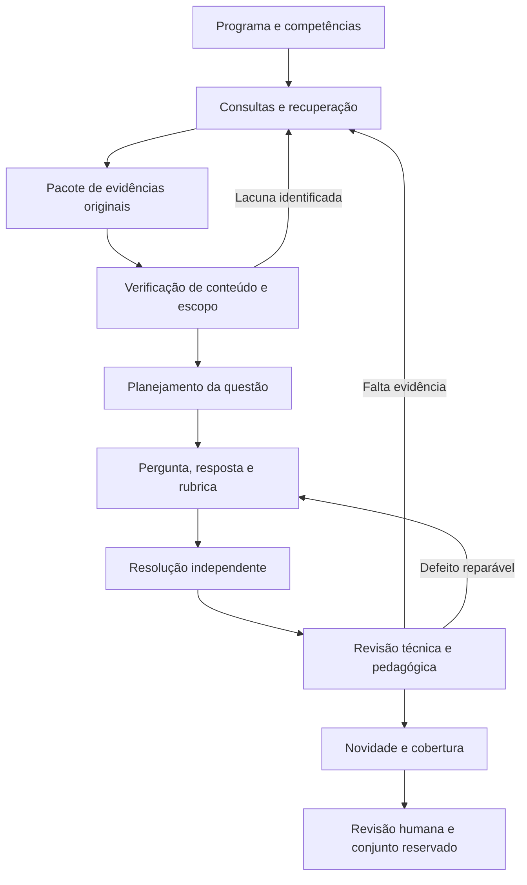

# Geração de perguntas e respostas com RAG: funcionamento, evidências e desenho de pipeline

Pesquisa realizada em **18–19 de outubro de 2026**, com foco no projeto MCQ_CONTEXT_GEN.

**Atualização de escopo:** a pedido do usuário, foi aprofundada a análise de código de métodos baseados em artigos científicos. O documento [Geração de QA científico: código, prompts, pesquisa no corpus e extração de conhecimento](metodos_cientificos_codigo.md) passa a ser a leitura principal. O levantamento abaixo conserva o contexto geral; benchmarks de conversação, livros, notícias ou enciclopédias ficam como referências secundárias.

## 1. Resultado principal e escopo

A geração de QA fundamentada em recuperação transforma um acervo em **itens de avaliação rastreáveis**. A unidade útil é um pacote que reúne pergunta, resposta de referência, critérios de correção, evidências originais e condições de validade. Redigir a pergunta é uma etapa desse processo.

Para o projeto, a arquitetura que recomendo investigar é:

**competência pretendida → pesquisa no acervo → evidências verificadas → planejamento do item → pergunta, resposta e rubrica → resolução independente → revisão técnica e pedagógica → análise de novidade → validação humana.**

Esta é uma síntese de engenharia a testar no domínio do projeto, não uma arquitetura cuja superioridade já tenha sido demonstrada aqui. O levantamento encontrou métodos úteis para cada parte, mas nenhum estudo consultado estabelece uma receita universal para questões técnicas em português sobre óleo e gás.

Trato **QA** como *question answering*, especialmente a produção de pares pergunta–resposta, e **QG/QAG** como geração de perguntas/geração de pares pergunta–resposta. Incluo uma extensão para múltipla escolha, pois esse formato integra o projeto.

O levantamento é uma **revisão narrativa orientada à implementação**, não uma revisão sistemática ou meta-análise. Foram priorizados artigos originais, páginas oficiais de publicação, documentação e código dos autores. Foram consultados trabalhos de 2019 a 2026, com profundidade de leitura variável: seções metodológicas e apêndices de vários trabalhos, resumos oficiais de outros e prompts públicos do Ragas. Não foram executados experimentos, chamadas aos deployments do projeto ou alterações no pipeline.

Na parte local, foram examinados o README principal, os READMEs de `qa_v11` e `documentos_tecnicos`, o recuperador e partes dos contratos de `qa_v11`, além de pesquisas e análise de piloto já existentes. Essa inspeção não constitui auditoria integral da implementação ou dos corpora. A análise prévia do piloto é tratada como diagnóstico registrado no projeto, não como nova validação humana feita nesta pesquisa.

## 2. Quatro tarefas relacionadas, com objetivos diferentes

| Tarefa | Entrada e saída | O que precisa ser avaliado |
| --- | --- | --- |
| Responder com RAG | Pergunta existente → busca → resposta | Recuperação, correção e sustentação da resposta |
| Gerar QA para avaliação | Acervo e objetivos → perguntas, respostas e evidências | Qualidade dos itens e representatividade da avaliação |
| Gerar QA para treinamento | Acervo → exemplos sintéticos → ajuste de um modelo | Ganho em dados de teste independentes, ruído e contaminação |
| Gerar perguntas para melhorar a recuperação | Documento → consultas sintéticas associadas a ele | Melhoria do recuperador em consultas reais reservadas |

O RAG original combina memória paramétrica do modelo com recuperação externa para produzir linguagem. Nos sistemas atuais, essa combinação também pode ser montada com recuperação e prompts, sem retreinar o modelo. A formulação de Lewis et al. é a referência histórica, não uma exigência de que todo pipeline moderno reproduza seu treinamento conjunto. [Lewis et al., 2020](https://arxiv.org/abs/2005.11401).

**Gerar perguntas a partir de documentos já fornecidos é geração fundamentada em contexto.** Quando existe uma etapa que procura e seleciona evidências em um acervo, há também recuperação aumentada. Um documento inteiro inserido manualmente no prompt não demonstra, por si, que o recuperador funcionou. Essa distinção permite descrever corretamente os experimentos do projeto.

Também convém separar geração de questões para um benchmark e geração para treinamento de um recuperador. O InPars, por exemplo, utiliza consultas sintéticas para construir dados de treinamento de recuperação. Isso não equivale a certificar questões para uma prova profissional. [Bonifacio et al., 2022](https://arxiv.org/abs/2202.05144).

## 3. Como a geração funciona quando a pergunta ainda não existe

No QA convencional, a pergunta orienta a busca. Na geração de perguntas, precisamos definir **o que orientará a primeira recuperação**. As entradas possíveis incluem:

- um tema ou subtópico definido pelo especialista;
- uma competência, como comparar alternativas sob determinadas condições;
- uma entidade ou relação extraída do acervo;
- um trecho inicialmente amostrado, a partir do qual se buscam explicações e complementos;
- uma lacuna identificada durante a preparação de um item.

Uma descrição operacional útil é:

```text
o = objetivo de avaliação
C = corpus autorizado
E = recuperar(C, consultas derivadas de o)
V = verificar e organizar E
(q, a, r) = gerar(V, o, exemplos), com r = rubrica
b = resolver(q, V), sem mostrar a resposta a
decisão = revisar(q, a, r, b, V)
```

A ordem de produção de `q` e `a` pode variar. A evidência e o critério de correção, entretanto, precisam permanecer identificáveis ao final.



### 3.1 Preparar e delimitar o corpus

A preparação deve conservar a ligação entre cada trecho e o documento de origem. Para texto técnico, isso inclui título, seção quando conhecida, edição, data, página disponível, tipo de documento e contexto de aplicação.

Uma recomendação de um relatório de incidente, uma hipótese de dissertação e um requisito de um procedimento têm estatutos diferentes. O pipeline deve preservar essas diferenças ao produzir uma resposta de referência. Fidelidade ao que um documento diz e validade de uma conclusão para o problema proposto são verificações distintas.

Também é necessário registrar o que se perdeu na extração: tabelas, desenhos, fórmulas, unidades, referências cruzadas e fronteiras documentais. Uma transcrição fluente produzida por um modelo não recupera automaticamente informação que desapareceu do original.

### 3.2 Dividir e indexar sem destruir o significado

Os segmentos precisam comportar unidades interpretáveis. Para documentos técnicos, a proposta inicial é respeitar seções, definições com suas condições, procedimentos com suas exceções e tabelas com cabeçalhos e notas.

O trecho pequeno facilita localização, mas pode omitir a condição que muda sua interpretação. O trecho grande conserva contexto, mas acrescenta ruído. Por isso, proponho testar recuperação de segmentos menores com expansão para a seção ou vizinhança pertinente.

Não há tamanho universal de trecho demonstrado pelas fontes consultadas para o corpus do projeto. Tamanho, sobreposição e expansão devem ser parâmetros do experimento. A documentação do Ragas também admite divisão hierárquica e segmentadores específicos do domínio. [Documentação oficial de geração de testes](https://docs.ragas.io/en/stable/concepts/test_data_generation/rag/).

### 3.3 Recuperar candidatos e selecionar evidências

Há três mecanismos que podem ser comparados:

| Mecanismo | Sinal utilizado | Hipótese de utilidade no projeto |
| --- | --- | --- |
| BM25 | Correspondência lexical, frequência dos termos e comprimento do texto | Siglas, nomes de equipamentos e terminologia técnica explícita |
| Busca densa | Representações vetoriais de consulta e documento | Paráfrases e formulações diferentes do mesmo conceito |
| Busca híbrida com reordenação | Combinação dos candidatos e nova análise da pertinência | Complementaridade lexical/semântica, a confirmar por avaliação |

Essas utilidades são hipóteses de desenho, não um ranking comprovado no Petrolês. Pontuações BM25 e similaridades vetoriais não devem ser somadas como se estivessem na mesma escala; pode-se comparar fusão por posições ou uma normalização validada. Reordenar candidatos também não recupera um documento que nunca entrou no conjunto inicial.

A busca deve responder a uma necessidade do item. Uma consulta inicial pode localizar o conceito; outra pode procurar a condição de aplicação ou a exceção ausente. Cada rodada precisa registrar a lacuna, a consulta e se o resultado a resolveu. Repetir consultas até preencher a janela de contexto não assegura completude.

O RAQAG, publicado em 2026, descreve recuperação vetorial, BM25 e BGE Reranker em seu módulo de QAG. Isso confirma uma implementação possível de busca híbrida; não demonstra que essa combinação será a melhor para este projeto. [Resumo e prévia do artigo](https://www.sciencedirect.com/science/article/pii/S095070512600568X), [repositório dos autores](https://github.com/Fakerfigure/QAG_System).

### 3.4 Construir um pacote verificável de evidências

O pacote deve distinguir:

1. **Texto original**, com localização disponível e identificação estável.
2. **Afirmação extraída**, mantendo sujeito, condição, alcance e estatuto.
3. **Relação de suporte**, indicando qual passagem sustenta qual afirmação.
4. **Lacunas ou conflitos**, que impedem ou limitam um objetivo de avaliação.

Uma referência existente não é prova de suporte semântico. Verificar que a citação aparece literalmente na fonte evita referências fabricadas, mas ainda é necessário conferir se ela sustenta a conclusão e se o contexto é compatível.

O MultiHop-RAG oferece um exemplo concreto: extrai evidências, produz afirmações desambiguadas, verifica alinhamento e encontra entidades ou temas de conexão antes de gerar QA. A construção usa notícias e formatos de resposta restritos, o que limita sua transferência direta para QA técnico explicativo. [Método e apêndices](https://arxiv.org/html/2401.15391v1).

### 3.5 Planejar o item antes de redigir

A seleção do conteúdo deve ser orientada por uma matriz de avaliação: tema, competência, condições, tipo de resposta e evidências necessárias. O programa do especialista define o universo desejado; a recuperação informa quais partes desse universo estão suficientemente sustentadas.

Isso evita que o banco de questões apenas reflita os trechos mais abundantes ou mais fáceis de recuperar. Uma pergunta sobre definição, uma comparação causal e um diagnóstico condicionado podem compartilhar palavras e avaliar competências distintas. Duas perguntas com cenários diferentes podem exigir a mesma resposta.

### 3.6 Produzir pergunta, resposta e rubrica

Há três ordens comuns de geração:

| Ordem | Como funciona | Vantagem prática | Limite a verificar |
| --- | --- | --- | --- |
| Resposta primeiro | Seleciona resposta ou afirmação e gera uma pergunta compatível | Âncora de conteúdo explícita | Pode concentrar os itens em extração e memorização |
| Geração conjunta | Produz pergunta e resposta na mesma chamada | Economia e coerência local | O autor pode criar um par coerente com uma premissa equivocada |
| Pergunta primeiro | Gera uma dúvida relevante e procura como respondê-la | Pode aproximar-se das necessidades de usuários/especialistas | Pode exigir conhecimento ausente do corpus |

As três são opções legítimas, dependendo do objetivo. O SimRAG exemplifica resposta primeiro: extrai respostas candidatas, gera perguntas condicionadas no documento e na resposta e filtra dados para adaptação de modelos. No filtro descrito na versão consultada, busca-se a presença da resposta nos documentos recuperados. **Esse critério não comprova sozinho a correção de uma resposta explicativa.** [SimRAG, seção 3.3](https://arxiv.org/html/2410.17952v1).

Nos prompts públicos consultados, o Ragas gera pergunta e resposta juntas, condicionado por contexto, persona, tema, estilo e extensão. O prompt de um salto exige fidelidade ao contexto; o de múltiplos saltos pede conexão entre segmentos. Essas instruções são mecanismos de geração, não certificados de qualidade do resultado. [Prompt de um salto](https://raw.githubusercontent.com/vibrantlabsai/ragas/main/src/ragas/testset/synthesizers/single_hop/prompts.py), [prompt de múltiplos saltos](https://raw.githubusercontent.com/vibrantlabsai/ragas/main/src/ragas/testset/synthesizers/multi_hop/prompts.py).

Para QA aberto, a rubrica deve registrar o conteúdo indispensável, variantes aceitáveis, condições necessárias e erros que invalidam a resposta. A redação de referência é uma realização possível desses critérios; uma paráfrase correta deve poder receber a mesma avaliação.

## 4. O que aproveitar dos trabalhos centrais

| Trabalho | Contribuição relevante | Limite de transferência |
| --- | --- | --- |
| [Roundtrip Consistency, ACL 2019](https://aclanthology.org/P19-1620/) | Combina geração de perguntas e extração de respostas, filtrando pela consistência do retorno | Foi desenvolvido para QA extrativo; concordância entre modelos não certifica domínio técnico |
| [Ragas, documentação oficial](https://docs.ragas.io/en/stable/concepts/test_data_generation/rag/) | Organiza contextos relacionados em grafo e gera cenários e consultas de diferentes tipos | Representatividade depende da distribuição escolhida; não oferece validação pedagógica automática |
| [Auto-RAG-Eval, 2024](https://arxiv.org/html/2405.13622v1) | Gera exames MCQ a partir do corpus, aplica filtros e analisa informação dos itens com TRI | Avalia sistemas RAG; bons resultados de modelos não equivalem a uma prova validada para profissionais |
| [RAFT, 2024](https://arxiv.org/html/2403.10131v1) | Usa evidência pertinente e documentos distratores para treinar leitura robusta em RAG | É uma receita de treinamento; suas justificativas sintéticas não são gabaritos humanos certificados |
| [MultiHop-RAG, 2024](https://arxiv.org/html/2401.15391v1) | Conecta afirmações apoiadas em evidências e conserva conjuntos de suporte | Notícias e respostas restritas diferem do QA técnico aberto |
| [MuSiQue, TACL 2022](https://arxiv.org/abs/2108.00573) | Compõe questões cujas etapas dependem umas das outras e combate atalhos | O desenho do dataset não se transfere automaticamente a conceitos de engenharia |
| [SciQAG, 2024](https://arxiv.org/abs/2405.09939) | Separa gerador e avaliador de QA científico, com avaliação em várias dimensões | Texto científico pode conter resultados particulares; geração documental não assegura aplicação geral |
| [SimRAG, 2024](https://arxiv.org/abs/2410.17952) | Gera QA sintético para adaptar modelos a domínios especializados | Melhoria no modelo treinado é um objetivo diferente da qualidade de uma avaliação humana |
| [ExpertGenQA, Findings EMNLP 2025](https://aclanthology.org/2025.findings-emnlp.159/) | Combina exemplos de especialistas com categorização por tema e estilo | Resultados em segurança ferroviária não estabelecem validade em óleo e gás ou português |
| [RAQAG, 2026](https://www.sciencedirect.com/science/article/pii/S095070512600568X) | Integra preparação, geração com recuperação e avaliação de QA | Acesso ao resumo/prévia e README; não foi auditado o artigo integral nem reproduzidos seus resultados |

Dois resultados ajudam a interpretar esses métodos:

- No ExpertGenQA, a acurácia top-1 de recuperação reportada passa de **23,96% para 36,98%**, diferença de **13,02 pontos percentuais**. É um ganho no experimento de recuperação, não uma taxa de acerto humano das perguntas. O trabalho também observa sensibilidade de avaliadores automáticos à reformulação estilística. [Artigo, seções 1 e 6.2](https://aclanthology.org/2025.findings-emnlp.159.pdf).
- O Auto-RAG-Eval compara respostas sem corpus, com recuperação e com o documento usado para gerar o item. Essa condição de evidência ideal ajuda a localizar falhas do recuperador e do respondente; não é um limite matemático garantido para todo modelo ou contexto. [Seção 4.2](https://arxiv.org/html/2405.13622v1).

No RAQAG, a prévia acessível esclarece que o chamado ciclo fechado opera como seleção de exemplos por qualidade para treinamento, e não necessariamente como refinamento iterativo de cada questão. Portanto, o termo *closed-loop* precisa ser interpretado pelo mecanismo efetivamente implementado. [Prévia do artigo](https://www.sciencedirect.com/science/article/pii/S095070512600568X).

## 5. Como gerar perguntas que exijam raciocínio

### 5.1 Raciocínio exige dependência entre informações

Ter dois documentos no prompt não comprova raciocínio de múltiplos saltos. A pergunta pode ser respondida por apenas um, ou pode simplesmente pedir duas informações independentes. O MuSiQue foi construído justamente para reduzir atalhos em perguntas multihop. [Trivedi et al.](https://arxiv.org/abs/2108.00573).

Proponho distinguir:

- **Recuperação direta:** localizar uma definição ou condição explícita.
- **Composição:** reunir informações que podem ser obtidas separadamente.
- **Integração:** usar uma informação para interpretar ou selecionar outra.
- **Aplicação:** empregar um princípio em um cenário cujas condições estão explícitas.
- **Avaliação:** comparar propostas por critérios determinados e justificar a conclusão.

Essas categorias são uma proposta operacional para o projeto. O rótulo cognitivo deve ser conferido pela tarefa necessária para responder. Verbos como “analise” e “justifique” não tornam automaticamente a questão mais complexa.

### 5.2 Exemplo didático de integração real

Considere um sistema **inteiramente fictício**, criado apenas para explicar o mecanismo de geração:

- **E1:** o modo M só pode ser selecionado quando X e Y estiverem confirmados.
- **E2:** no cenário S, a observação disponível confirma X, mas não permite concluir Y.

Pergunta direta: “Quais são as condições para selecionar M?” Depende apenas de E1.

Pergunta integrada: “No cenário S, as informações disponíveis permitem concluir que M pode ser selecionado? Identifique a condição ainda não demonstrada.”

Resposta de referência: “Não. X está confirmado, mas a confirmação de Y continua ausente.”

Rubrica: reconhecer que as duas condições são necessárias; usar E2 para identificar a lacuna em Y; não confundir ausência de confirmação com demonstração de que Y é falso.

Para verificar a integração, pode-se retirar E1 ou E2 e observar o que deixa de ser justificável. O teste é diagnóstico: um respondente pode acertar por conhecimento prévio ou inferência de padrões, e um erro isolado não prova dependência. Deve-se combinar o teste com inspeção explícita das relações necessárias à resposta.

### 5.3 Dificuldade não é o mesmo que qualidade

Uma questão pode ser difícil por exigir uma aplicação relevante, mas também por ambiguidade, informação insuficiente ou terminologia mal explicada. A taxa de erro de um LLM deve ser interpretada com a resolução e a revisão do item.

Para profissionais humanos, dificuldade precisa ser estudada com respostas da população pretendida. Para modelos, pode-se estudar dificuldade relativa a um painel de sistemas. Os parâmetros obtidos para uma população não devem ser automaticamente atribuídos à outra. A TRI pode ser útil depois de um desenho amostral adequado; não há base para definir um mínimo universal de itens e respondentes nesta pesquisa.

## 6. Gerar uma nota ou capítulo antes das questões

O projeto já explora uma etapa intermediária de redação técnica. Ela pode organizar evidências dispersas, explicitar mecanismos e apoiar perguntas que ultrapassem a cópia de uma frase.

O custo conceitual é acrescentar uma transformação que também pode introduzir erros. Uma inferência sem apoio pode aparecer no capítulo, ser reproduzida pelo gerador e depois parecer correta a um juiz que recebeu apenas esse mesmo capítulo.

Proponho conservar esta cadeia:

```text
afirmação da resposta
    → afirmação do capítulo, se houver
        → trecho(s) original(is)
            → documento e condições de aplicação
```

O capítulo deve funcionar como síntese pedagógica verificável. As fontes originais precisam continuar disponíveis ao revisor. Questões geradas a partir de trechos diretos e questões geradas com uma nota podem ser comparadas mantendo constantes os objetivos e a evidência de base.

Há dois efeitos experimentais diferentes: **organizar melhor a mesma evidência** e **buscar mais evidência**. Se uma variante faz ambos, o ganho total não permite atribuir o resultado apenas à redação da nota. O README de `qa_v11` já documenta essa distinção entre suas configurações.

## 7. Verificação: o que cada etapa pode estabelecer

### 7.1 Verificações estruturais

São apropriadas para código determinístico: campos obrigatórios, identificadores válidos, quantidade de alternativas, citação literal presente, ausência de resposta vazia e integridade dos metadados.

Um JSON válido comprova estrutura. Uma citação encontrada comprova existência textual. Nenhuma das duas estabelece, isoladamente, que a pergunta é correta ou relevante.

### 7.2 Resolução independente e consistência de retorno

O respondente recebe a pergunta e as evidências, mas não a resposta de referência nem a rubrica do autor. Sua resposta é comparada ao gabarito por conteúdo, aceitando equivalências previstas. Esse procedimento adapta o princípio de consistência de retorno usado na geração de QA extrativo. [Alberti et al., 2019](https://aclanthology.org/P19-1620/).

Divergência exige diagnóstico: pode haver ambiguidade, gabarito incompleto, falta de evidência ou erro do respondente. Concordância é um sinal útil, mas modelos podem compartilhar os mesmos erros. Separar papéis ou usar outro modelo reduz algumas formas de influência direta sem assegurar independência estatística.

### 7.3 Revisão técnica e pedagógica

O revisor deve distinguir pelo menos: suporte da resposta, aplicabilidade das fontes, clareza da pergunta, suficiência das premissas, adequação da rubrica e relevância da competência.

Convém preservar os resultados por dimensão. Uma média alta de clareza e relevância não compensa uma conclusão técnica sem suporte. A decisão deve admitir aprovação, correção do enunciado, revisão do gabarito, recuperação adicional, rejeição e insuficiência de evidência.

### 7.4 Verificação de novidade

Novidade precisa considerar **competência + condições + conclusão/rubrica**, além da formulação textual. Similaridade pode localizar candidatos a repetição, mas o corte numérico sozinho não explica se dois itens avaliam a mesma coisa.

O exame deve alcançar os itens aprovados do recorte pertinente e manter uma matriz de cobertura. Alterar o nome da instalação, trocar números irrelevantes ou acrescentar um cenário sem efeito na resposta não cria necessariamente um novo item.

### 7.5 Revisão humana e calibração dos avaliadores

O conjunto reservado deve incluir questões boas e falhas representativas: generalização indevida, ambiguidade, resposta incompleta, repetição e uso superficial de múltiplas evidências. Os rótulos humanos precisam ser produzidos sem mostrar a decisão automática, quando o desenho exigir avaliação cega.

Uma amostra aleatória permite estimar a qualidade do lote; uma seleção de casos difíceis ajuda a diagnosticar falhas. Se houver amostragem estratificada ou enriquecida em erros, as estimativas agregadas precisam considerar essa seleção. É útil revisar também rejeitadas para descobrir falsas reprovações.

O ARES é uma referência para calibrar avaliação automática com rótulos humanos e incorporar incerteza estatística. Sua aplicação envolve juízes treinados e inferência assistida por predições, não simplesmente a média de notas fornecidas por um LLM. [Saad-Falcon et al., NAACL 2024](https://aclanthology.org/2024.naacl-long.20/).

## 8. Como avaliar o sistema sem misturar os problemas

Há três objetos de avaliação: **a recuperação**, **os itens gerados** e **o sistema que responde aos itens**. Um pode melhorar sem que os demais melhorem.

| Objeto | Medidas propostas | Interpretação e cuidado |
| --- | --- | --- |
| Recuperação | Recall@k de evidências relevantes, ordenação, cobertura das afirmações necessárias | IDs de trechos sobrepostos precisam ser tratados; uma evidência alternativa válida não deve ser marcada como erro apenas por ter outro ID |
| Sustentação | Proporção de afirmações materiais da resposta apoiadas pelas fontes | A extração das afirmações e a decisão de suporte também podem errar |
| Qualidade dos itens | Validade técnica, clareza, suficiência, relevância, adequação da rubrica | Exige revisão calibrada e uma amostra humana |
| Cobertura | Competências e condições representadas; lacunas por tópico | Contagem de perguntas não mede amplitude do banco |
| Novidade | Redundância por competência e rubrica | Paráfrase e novidade conceitual são propriedades diferentes |
| Respondente | Correção/completude, sustentação, abstenção apropriada | Uma resposta diferente da referência pode estar correta |
| Operação | Tokens, tempo, tentativas, falhas, custo por item validado | Taxa de aprovação automática não é taxa de validade humana |

Para o custo, uma medida útil é:

```text
custo por item validado = custo total da execução / número de itens válidos confirmados
```

Se apenas uma amostra foi revisada, o denominador real ainda não é conhecido para o lote inteiro. Pode-se reportar custo por aprovação automática e, separadamente, uma estimativa de custo por item válido, com a incerteza e o método amostral declarados.

O RAGAs organiza avaliação por aspectos como fidelidade e relevância. Essas métricas são úteis para diagnosticar respostas, mas não cobrem automaticamente a qualidade pedagógica de uma pergunta gerada. [Artigo original, EACL 2024](https://aclanthology.org/2024.eacl-demo.16/).

O RAGChecker propõe decompor respostas e referências em afirmações e analisar as relações entre elas e o contexto. Essa decomposição ajuda a distinguir conteúdo faltante na recuperação, conteúdo recuperado e ignorado, e conteúdo acrescentado sem apoio. A confiabilidade depende também do extrator e do verificador empregados. [Tutorial oficial](https://github.com/amazon-science/RAGChecker/blob/main/tutorial/ragchecker_tutorial_en.md).

### 8.1 Quatro condições para testar o respondente

Para um conjunto de perguntas **fixo**, proponho:

| Condição | Informação fornecida | Diagnóstico possível |
| --- | --- | --- |
| Sem consulta | Apenas a pergunta | Conhecimento prévio e possíveis atalhos |
| Evidência de referência | Evidência curada suficiente para o item | Capacidade de responder com suporte disponível |
| Recuperação real | Resultado do recuperador em avaliação | Desempenho completo da combinação busca–resposta |
| Evidência com distratores | Suporte pertinente e material plausível irrelevante | Resistência a ruído |

A condição com distratores tem relação com a motivação de robustez do RAFT, embora a proposta aqui seja um diagnóstico do respondente e não sua receita de treinamento. [RAFT](https://arxiv.org/html/2403.10131v1).

Se o respondente falha com evidência suficiente, deve-se investigar interpretação, gabarito e geração da resposta. Se vai bem nessa condição e piora com recuperação real, a recuperação é uma hipótese de gargalo a verificar. Acertar sem consulta não invalida automaticamente um item: pode ser adequado para avaliar conhecimento humano, embora menos informativo sobre o benefício do RAG.

### 8.2 Evitar seleção circular e contaminação

O banco usado para ajustar prompts não deve ser o mesmo conjunto reservado para a avaliação final. Também é necessário separar demonstrações, dados de calibração do juiz, treinamento e teste.

Para benchmarks de RAG, evitar indexar os gabaritos ou as próprias perguntas de teste como documentos pesquisáveis. Se o corpus contém FAQs originais, registrar isso e controlar duplicação. O acesso aos documentos-fonte pode ser parte legítima da tarefa aberta à consulta; o acesso acidental ao par pergunta–gabarito muda a tarefa.

Não recomendo aceitar somente itens respondíveis pelo recuperador atual quando a finalidade é comparar recuperadores. Esse filtro pode selecionar um benchmark favorável a ele. Para dados de treinamento, uma seleção orientada ao sistema pode fazer sentido, desde que o teste permaneça independente.

## 9. Extensão para múltipla escolha

O QA aberto precisa de pergunta, resposta e rubrica. A múltipla escolha acrescenta o problema de construir **alternativas erradas plausíveis e inequivocamente erradas nas condições do enunciado**.

Uma sequência proposta é validar primeiro a resposta e depois criar distratores ligados a erros de raciocínio relevantes. Para cada opção, conservar uma justificativa interna que explique por que ela é correta ou incorreta. Depois verificar alternativas parcialmente verdadeiras, equivalências, condições omitidas e pistas de redação.

Uma opção pode expressar um fato verdadeiro e ainda ser inadequada à pergunta; por isso, avaliar apenas se “a alternativa aparece na fonte” é insuficiente. Também é necessário conferir se o enunciado permite mais de uma resposta.

Há pesquisa específica sobre geração de distratores com pré-treinamento aumentado por recuperação e integração de grafos. Isso evidencia que distratores são uma tarefa própria; não estabelece a necessidade de incorporar esse treinamento ao pipeline atual. [Yu et al., Findings ACL 2024](https://aclanthology.org/2024.findings-acl.655/).

Para o experimento, proponho verificar resolução sem mostrar as alternativas, depois com alternativas, e eventualmente sob permutação das opções. Essas condições ajudam a identificar pistas e dependência da posição, mas não substituem a avaliação de especialistas.

## 10. Documentos com tabelas, figuras e diagramas

Quando o suporte depende de uma figura ou tabela, o pacote deve preservar essa modalidade ou uma representação verificável dela. A legenda isolada pode não bastar; uma descrição automática de imagem também pode omitir a relação necessária à resposta.

O SMMQG combina recuperador, modelo de linguagem e modelo multimodal para gerar pares com estilos e modalidades definidos, incluindo texto, tabelas e imagens. A pesquisa também realiza avaliação humana e compara a utilidade do conjunto sintético com um benchmark existente. [Wu et al., 2024](https://arxiv.org/html/2407.02233v1).

Para este projeto, proponho registrar que o item está bloqueado quando depende de informação visual não disponível. Se essa lacuna for frequente e relevante para as competências, ela justifica investigar uma etapa multimodal específica. A decisão deve partir das lacunas observadas.

## 11. Contratos de tarefa propostos

Os exemplos abaixo são **propostas originais desta pesquisa**, não transcrições dos prompts dos artigos nem versões já testadas nos deployments do projeto. O conteúdo variável deve ser separado das instruções e das demonstrações.

### Preparação das evidências

> Examine os trechos originais para o objetivo informado. Identifique afirmações relevantes, condições e limites de aplicação. Relacione cada afirmação às passagens que a sustentam. Registre conflitos, dependências de informação ausente e lacunas que impedem avaliar o objetivo.

### Geração

> Produza uma questão para a competência e as condições definidas, usando as evidências aprovadas. Inclua os dados necessários para interpretar o problema, uma resposta de referência e critérios de correção que aceitem respostas semanticamente equivalentes. Indique o suporte das conclusões materiais. Se a evidência for insuficiente, descreva a lacuna.

### Resolução independente

> Responda à pergunta usando as evidências disponíveis. Explicite as premissas necessárias e relacione as conclusões ao suporte correspondente. Se as informações permitirem respostas diferentes ou forem insuficientes, identifique o ponto que impede uma conclusão determinada.

### Revisão

> Compare pergunta, resposta de referência, rubrica, resolução independente e fontes originais. Verifique sustentação, aplicabilidade, suficiência, clareza e relevância da competência. Identifique o defeito concreto e decida entre aprovar, corrigir, revisar o gabarito, buscar evidência ou rejeitar. A aprovação de uma dimensão não deve ocultar uma falha material em outra.

Uma implementação possível conserva, além do texto final:

```json
{
  "id": "atribuido_pelo_codigo",
  "objetivo_id": "O01",
  "pergunta": "...",
  "resposta_referencia": "...",
  "rubrica": ["conteudo indispensavel", "condicao necessaria"],
  "variantes_aceitaveis": ["..."],
  "premissas": ["..."],
  "suporte": [{"afirmacao_id": "A01", "evidencia_ids": ["E01"]}],
  "dependencias": ["A01"],
  "status": "candidata",
  "versao": 1
}
```

As evidências completas, metadados, respostas dos avaliadores e histórico ficam vinculados a esse registro. Identificadores e hashes devem ser controlados pelo código. Um valor de confiança autodeclarado pelo modelo não deve ser interpretado como probabilidade calibrada de correção.

## 12. Aplicação ao MCQ_CONTEXT_GEN

### 12.1 O que a inspeção local permite afirmar

O projeto já dispõe de várias partes da arquitetura recomendada:

- `pipeline/qa_v11/retrieval.py` implementa recuperação lexical com SQLite FTS5/BM25, deduplicação textual e adição condicionada de contexto vizinho.
- `pipeline/qa_v11/contracts.py` define campos para resposta, rubrica, suporte, premissas e dependências, além de distinguir estatutos das afirmações.
- O README de `qa_v11` descreve configurações com evidências diretas, nota e nota com complemento, e separa resolução independente de julgamento.
- O README de `documentos_tecnicos` descreve pesquisa, redação e revisão de um documento antes de dois lotes de candidatas, com avaliação individual.
- A análise local anterior do piloto registra problemas de escopo das fontes, delimitação de respostas e redundância apesar de aprovações automáticas. Trata-se de um diagnóstico prévio do assistente, não de rótulos humanos novos.

Essas observações apontam para avaliar a qualidade das transformações e decisões já existentes antes de assumir que a falta de um framework ou de embeddings explica os problemas. A pesquisa não demonstrou um defeito específico do recuperador atual nem mediu uma alternativa melhor.

### 12.2 Experimento inicial recomendado

Proponho separar duas perguntas experimentais.

**A. Qual é o efeito do suporte fornecido ao autor das questões?**

| Condição | Entrada para geração | Efeito estudado |
| --- | --- | --- |
| A0 | Tema, competência e exemplos; sem corpus | Baseline instruction-only |
| A1 | Mesmos elementos e pacote de evidências fixo | Efeito da disponibilização de evidência |
| A2 | Mesma evidência de A1, mais nota verificada | Efeito da síntese pedagógica |
| A3 | Nota e busca complementar motivada por lacunas | Efeito do processo completo de complemento |

Manter modelo, rubrica de avaliação, recortes e orçamento comparáveis. Os exemplos também precisam ser iguais entre condições, separados do teste e sem revelar a resposta dos itens experimentais; exemplos técnicos já transportam algum conhecimento. A3 pode mudar o conhecimento disponível e os objetivos viáveis; sua comparação exige registrar essas mudanças. Falta de evidência deve ser resultado observável, sem substituição silenciosa do objetivo.

**B. Qual recuperador sustenta melhor perguntas fixas?**

Comparar BM25, busca densa e híbrida sobre as mesmas perguntas e evidências de referência curadas. Aplicar também as condições de resposta sem consulta e com evidência suficiente. Essa segunda comparação avalia recuperação sem regenerar o benchmark para cada recuperador.

Um piloto pode usar poucos recortes e dezenas de candidatas para identificar defeitos e estimar esforço de revisão. O tamanho confirmatório deve ser definido depois, conforme variabilidade, efeito de interesse e capacidade de anotação. Não apresento uma quantidade arbitrária como garantia de significância.

### 12.3 O que medir prioritariamente

1. Validade técnica confirmada por especialista, com contagem e incerteza.
2. Cobertura das competências e repetição conceitual.
3. Falsas aprovações e falsas reprovações dos avaliadores automáticos.
4. Sustentação e aplicabilidade das conclusões do gabarito.
5. Custo e tempo por candidata e por item válido.

As comparações devem reportar todas as candidatas, insuficiências e falhas operacionais. Comparar somente o lote final de aprovadas pode esconder quantas tentativas cada método consumiu. Quando o objetivo for comparar rendimento, o orçamento precisa fazer parte do desenho.

### 12.4 Organização sugerida do notebook

| Bloco | Resultado que deve ficar inspecionável |
| --- | --- |
| 1. Configuração e assinatura | Corpus, versões, modelos, objetivos, condições experimentais e orçamento |
| 2. Inventário do corpus | Documentos disponíveis, qualidade da extração e lacunas |
| 3. Recuperação | Consultas, candidatos, ordenação e expansão de contexto |
| 4. Evidências e competências | Afirmações verificadas e objetivos viáveis ou bloqueados |
| 5. Síntese opcional | Nota com vínculos às evidências e revisão |
| 6. Geração | Candidatas com resposta e rubrica |
| 7. Verificação | Resolução independente, julgamento e revisões versionadas |
| 8. Banco e cobertura | Itens distintos, repetidos, lacunas e motivos de decisão |
| 9. Revisão humana | Amostra cega, rótulos e adjudicação de divergências |
| 10. Comparação | Métricas, custos, intervalos e exemplos de falhas |

O notebook pode apresentar esses artefatos enquanto a lógica permanece nos módulos existentes. Esta pesquisa não cria nem modifica esse notebook.

## 13. Questões em aberto e limites da evidência

- A revisão consultada não permite quantificar o ganho esperado no domínio do projeto.
- Não foram comparados embeddings, segmentadores ou modelos de português no corpus local.
- Não foi demonstrado que redigir um capítulo antes de gerar QA supera o uso de evidências diretas.
- Grande parte da literatura mede treinamento e desempenho de modelos. Esses resultados precisam ser separados da validade pedagógica e técnica de itens para pessoas.
- A concordância automática não transforma rótulos sintéticos em verdade de referência humana.
- Os estudos usam versões distintas de modelos, dados e prompts. Não se devem combinar percentuais como se viessem de um mesmo benchmark.
- Links para ramos `main`/`master` são mutáveis. Para um experimento reprodutível, registrar commits ou versões efetivamente utilizados.
- Para RAQAG, as conclusões aqui se restringem ao material acessível: resumo/prévia e README dos autores.

## 14. Referências e percurso de leitura

Os links abaixo identificam as fontes primárias usadas. “Método” significa consulta a conteúdo metodológico disponível, não reprodução do experimento nem auditoria completa de código.

| Fonte | Material consultado | Uso nesta pesquisa |
| --- | --- | --- |
| [Lewis et al. — RAG, 2020](https://arxiv.org/abs/2005.11401) | Resumo original | Formulação e finalidade do RAG |
| [Alberti et al. — Roundtrip Consistency, 2019](https://aclanthology.org/P19-1620/) | Página oficial e resumo | Princípio de consistência entre pergunta gerada e resposta recuperada |
| [Ragas — Testset Generation](https://docs.ragas.io/en/stable/concepts/test_data_generation/rag/) | Documentação oficial | Grafo, cenários e tipos de consultas |
| [Ragas — Single-hop prompt](https://raw.githubusercontent.com/vibrantlabsai/ragas/main/src/ragas/testset/synthesizers/single_hop/prompts.py) | Código do prompt | Condicionamento e exigência de fidelidade |
| [Ragas — Multi-hop prompt](https://raw.githubusercontent.com/vibrantlabsai/ragas/main/src/ragas/testset/synthesizers/multi_hop/prompts.py) | Código do prompt | Combinação de temas e segmentos |
| [Guinet et al. — Auto-RAG-Eval, 2024](https://arxiv.org/html/2405.13622v1) | Método, condições e apêndice de geração | Exames MCQ, filtros, condição de evidência ideal e TRI |
| [Zhang et al. — RAFT, 2024](https://arxiv.org/html/2403.10131v1) | Método e discussão de distratores | Separação entre suporte e material irrelevante |
| [Tang e Yang — MultiHop-RAG, 2024](https://arxiv.org/html/2401.15391v1) | Construção e avaliação | Afirmações, conexões e conjuntos de evidência |
| [Trivedi et al. — MuSiQue, 2021/2022](https://arxiv.org/abs/2108.00573) | Resumo original e registro TACL | Dependência entre etapas e combate a atalhos |
| [Wan et al. — SciQAG, 2024](https://arxiv.org/abs/2405.09939) | Resumo atualizado, método da v1 e repositório | Geração científica e avaliação multidimensional; sem combinar tamanhos de datasets entre versões |
| [Xu et al. — SimRAG, 2024](https://arxiv.org/html/2410.17952v1) | Método, especialmente seção 3.3 | Resposta primeiro, filtragem e adaptação de modelos |
| [Shahgir et al. — ExpertGenQA, 2025](https://aclanthology.org/2025.findings-emnlp.159.pdf) | Método, avaliação, viés de estilo e ablações | Exemplos de especialistas, cobertura e limites dos juízes |
| [Gao et al. — RAQAG, 2026](https://www.sciencedirect.com/science/article/pii/S095070512600568X) | Resumo/prévia indexados | Recuperação híbrida e esclarecimento do ciclo de seleção |
| [QAG_System — autores do RAQAG](https://github.com/Fakerfigure/QAG_System) | README | Fluxo de documentos, entidades, perguntas e respostas via Mini_RAG |
| [Bonifacio et al. — InPars, 2022](https://arxiv.org/abs/2202.05144) | Resumo original | Distinção entre gerar perguntas para treino de recuperação e para avaliação |
| [Wu et al. — SMMQG, 2024](https://arxiv.org/html/2407.02233v1) | Método e descrição da avaliação | QA com texto, tabelas e imagens |
| [Yu et al. — Distractor Generation, 2024](https://aclanthology.org/2024.findings-acl.655/) | Página oficial e resumo | Problema específico dos distratores |
| [Es et al. — RAGAs, 2024](https://aclanthology.org/2024.eacl-demo.16/) | Página oficial e resumo/artigo indexado | Dimensões da avaliação de respostas RAG |
| [Saad-Falcon et al. — ARES, 2024](https://aclanthology.org/2024.naacl-long.20/) | Resumo e descrição metodológica indexada | Calibração com anotações humanas e incerteza |
| [Ru et al. — RAGChecker, 2024](https://github.com/amazon-science/RAGChecker/blob/main/tutorial/ragchecker_tutorial_en.md) | Tutorial e README oficiais | Decomposição em afirmações e diagnóstico de recuperação/geração |

Para o foco científico solicitado, começar pela [análise de código](metodos_cientificos_codigo.md): **SciQAG → MDAQA → AIM-SciQA (prompts e dados) → OpenScholar (pesquisa)**. Os demais métodos desta revisão servem como referências complementares de geração e avaliação. RAFT e SimRAG tornam-se prioritários se o projeto incluir treinamento de modelos.
