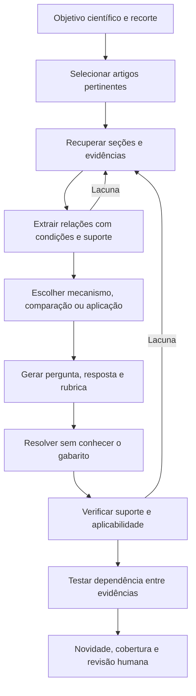

# Geração de QA científico: código, prompts, pesquisa no corpus e extração de conhecimento

**Recorte atualizado em 19/10/2026 conforme a orientação do usuário:** priorizar perguntas produzidas a partir de artigos científicos; examinar implementações reais; deixar fora da comparação principal bases de conversação, livros e conhecimento enciclopédico.

## 1. O que foi investigado

Foram lidos arquivos de **cinco repositórios**, incluindo os módulos que montam prompts, carregam documentos, recuperam contextos e avaliam os itens. Os links abaixo estão fixados nas revisões consultadas. A leitura foi estática: não foram instalados nem executados os projetos e não foram feitas chamadas aos modelos desses métodos.

Foi incluído um sexto método, AIM-SciQA, porque sua proposta é diretamente relevante para geração científica entre documentos. Nesse caso foram encontrados artigo, prompts e dados, mas não um repositório de construção nos materiais consultados. Ele permanece identificado como método descrito, sem código de implementação inspecionado.

| Método | Material que chega ao gerador de perguntas | Como seleciona esse material | Prioridade para este projeto |
| --- | --- | --- | --- |
| SciQAG | Texto de um artigo e palavras-chave | Artigos selecionados previamente; inferência documento a documento | Principal: conhecimento científico de um artigo |
| MDAQA | Textos de vários artigos, com títulos e IDs | Comunidades de artigos fornecidas como entrada | Principal: integração entre artigos |
| AIM-SciQA | Parágrafo na etapa atômica; pares QA e metadados na combinação final | Alinhamento semântico e, em uma variante, citações | Principal como desenho metodológico; código não localizado |
| ResearchQA/OpenPaper | PDF inteiro de um artigo | Coleta temática de artigos via OpenAlex | Complementar: prompts, rubricas e evidências por seção |
| OpenScholar | Seu fluxo principal recebe uma pergunta existente | Busca científica e recuperação de passagens | Complementar: como pesquisar e montar evidências |
| RAQAG/QAG_System | Lista de entidades acadêmicas extraídas do artigo | Resumo, introdução e conclusão; recuperação posterior para respostas | Adjacente: implementação de QAG com busca, aplicada sobretudo a gestão/economia |

Fontes de implementação: [SciQAG](https://github.com/MasterAI-EAM/SciQAG/blob/6c937bb405389ed0a0f4f66a83069b1662cb6625/Inference.ipynb), [MDAQA](https://github.com/YeloDriver/MDAQA/blob/b67471ff500e6592d98a26b28141d553d5c33a28/src/question_generator.py), [ResearchQA](https://github.com/khoj-ai/openpaper/blob/93ad62ffc63998cae0c0488595c67ae7cd8a6ceb/server/evals/generate_dataset.py), [OpenScholar](https://github.com/AkariAsai/OpenScholar/blob/0e9b8fb912273d3dae39e593da86e4f6d3bf8de1/src/open_scholar.py), [QAG_System](https://github.com/Fakerfigure/QAG_System/blob/d13a5993744668121cd8c565a2c4b441bae90dd3/e2e_QAG/e2e_QAG.py).

**Achado central:** “geração com RAG” pode descrever arquiteturas diferentes. Em algumas, o autor lê artigos completos; em outras, ele recebe somente entidades; em outras, recebe unidades de conhecimento previamente extraídas. A recuperação pode acontecer antes de elaborar a pergunta ou apenas depois, ao construir a resposta.

## 2. SciQAG: artigo completo, conceitos e geração científica autossuficiente

### Corpus e objetivo

O SciQAG trabalha com literatura científica, incluindo materiais, química, física e energia. A versão 2 descreve documentos em inglês obtidos em texto completo a partir de HTML/XML de editoras, selecionados por categorias do Web of Science. Seu objetivo inclui gerar QA científico que possa ser usado sem consultar o artigo original. [Artigo, versão 2](https://arxiv.org/html/2405.09939v2).

### O que o código realmente fornece ao gerador

Na primeira célula de `Inference.ipynb`, `input_format(data)` lê `data['txt']` e `data['keywords']`. `main(args)` acrescenta uma instrução de especialista em ciência dos materiais. O prompt pede dez pares aprofundados, diversidade, dados do artigo e foco em princípios; desencoraja perguntas meramente definicionais ou dependentes de uma figura específica. O notebook não chama um recuperador nessa etapa: passa o texto do artigo ao modelo. [Código: primeira célula, funções `input_format` e `main`](https://github.com/MasterAI-EAM/SciQAG/blob/6c937bb405389ed0a0f4f66a83069b1662cb6625/Inference.ipynb).

O conteúdo científico é interpretado durante a geração. Não há, nesse notebook, uma etapa intermediária que produza uma lista auditável de afirmações com trechos de suporte. Depois, `deal_qa` faz parsing e remove perguntas textualmente idênticas. Isso não equivale a uma análise de redundância conceitual. [Mesmo notebook, função `deal_qa`](https://github.com/MasterAI-EAM/SciQAG/blob/6c937bb405389ed0a0f4f66a83069b1662cb6625/Inference.ipynb).

### Prompt publicado e diferença em relação ao notebook

O apêndice C da versão 2 apresenta duas tarefas no mesmo pedido: extrair 15 conceitos específicos e gerar dez pares variados. Exige autonomia do enunciado e da resposta em relação a referências como “esta figura”. Já o notebook público espera palavras-chave prontas na entrada. Portanto, o código consultado não reconstrói toda a preparação descrita no artigo. O apêndice D publica os prompts de RACAR por dimensão. [Apêndices C e D](https://arxiv.org/html/2405.09939v2).

Essa diferença não prova que a extração de palavras-chave não foi realizada pelos autores; mostra que a inferência pública pressupõe essa etapa anterior.

### O que significa “extração de conhecimento” aqui

Os notebooks `data_process/scispacy.ipynb` e `term_complement2.ipynb` detectam e expandem abreviações nos QA já produzidos. O primeiro usa SciSpaCy; o segundo, regras de correspondência. Eles não devem ser apresentados como módulos de extração de relações científicas ou construção de grafos. [SciSpaCy](https://github.com/MasterAI-EAM/SciQAG/blob/6c937bb405389ed0a0f4f66a83069b1662cb6625/data_process/scispacy.ipynb), [expansão por regras](https://github.com/MasterAI-EAM/SciQAG/blob/6c937bb405389ed0a0f4f66a83069b1662cb6625/data_process/term_complement2.ipynb).

**Aplicação proposta:** usar esse método como baseline de geração a partir de artigo completo. Para nosso banco, acrescentaria rastreabilidade das conclusões e revisão de escopo. A instrução de produzir questões aprofundadas não demonstra que todas as saídas atingem essa qualidade.

## 3. MDAQA: comunidades de artigos e perguntas que precisam integrar fontes

### Como os documentos são encontrados e agrupados

O artigo descreve construir uma rede de citações e usar **SLPA**, um algoritmo de comunidades sobrepostas, para criar pequenos grupos de artigos relacionados. Depois, gera QA a partir desses grupos e propõe excluir questões resolvíveis por um artigo isolado. [Artigo, seção 3](https://aclanthology.org/2025.findings-emnlp.576v2.pdf).

O repositório consultado recebe as comunidades já prontas e um mapa entre identificadores Semantic Scholar e arXiv. Não localizei, entre seus módulos publicados, a implementação de construção da rede e execução do SLPA. O `DataLoader` carrega os textos pré-extraídos do SPIQA e concatena **título + arXiv ID + conteúdo**. Exige ao menos dois artigos e descarta conjuntos acima do limite configurado. [Carregamento e composição de contexto](https://github.com/YeloDriver/MDAQA/blob/b67471ff500e6592d98a26b28141d553d5c33a28/src/data_loader.py#L18).

Não é uma busca BM25 ou vetorial disparada pelo gerador. É seleção estrutural anterior, seguida de leitura conjunta dos documentos da comunidade.

O modelo de configuração publica limites de 10–200 KB por arquivo e 350.000 caracteres de contexto combinado. São parâmetros desse exemplo, não limites universais recomendados. O carregador também procura versões de arquivo de `v1` a `v14` e retorna a primeira elegível; isso exige atenção à edição efetivamente usada. [Configuração](https://github.com/YeloDriver/MDAQA/blob/b67471ff500e6592d98a26b28141d553d5c33a28/config/config_template.yaml), [carregador](https://github.com/YeloDriver/MDAQA/blob/b67471ff500e6592d98a26b28141d553d5c33a28/src/data_loader.py#L85).

### Como o prompt elabora a questão

O prompt de sistema atribui ao modelo o papel de sintetizar literatura e exige ao menos dois artigos interligados. `_create_user_prompt` orienta selecionar fontes, identificar uma conexão e construir uma pergunta. Exemplos de conexões incluem contraste metodológico, conflito de resultados e evolução técnica. Exige uma única frase interrogativa e proíbe perguntas genéricas, títulos e nomes de métodos no enunciado. A saída contém `Q`, `A`, `Reason` e `Support`. [Prompt e montagem](https://github.com/YeloDriver/MDAQA/blob/b67471ff500e6592d98a26b28141d553d5c33a28/src/question_generator.py#L14).

Não há um extrator separado de fatos nessa versão: o modelo encontra as conexões ao ler os artigos. O filtro imediato `_filter_single_support` exige mais de um ID distinto em `Support`. Ele conta fontes declaradas; não demonstra que todas são indispensáveis à resposta. [Filtro](https://github.com/YeloDriver/MDAQA/blob/b67471ff500e6592d98a26b28141d553d5c33a28/src/question_generator.py#L145).

### Uma divergência importante entre artigo e implementação

O avaliador público pede ao modelo uma resposta com um artigo e, na **mesma chamada**, fornece a resposta de referência e solicita uma comparação. Isso difere de produzir uma resolução sem conhecer o gabarito. Além disso, `generate_final_dataset()` lê o arquivo de QA e exporta seus itens sem consultar os resultados da avaliação. O comando `full` chama esse exportador após avaliar. Assim, o fluxo publicado não aplica ali o filtro final descrito no artigo. [Avaliador, prompt](https://github.com/YeloDriver/MDAQA/blob/b67471ff500e6592d98a26b28141d553d5c33a28/src/quality_evaluator.py#L81), [exportação](https://github.com/YeloDriver/MDAQA/blob/b67471ff500e6592d98a26b28141d553d5c33a28/src/quality_evaluator.py#L161), [orquestração](https://github.com/YeloDriver/MDAQA/blob/b67471ff500e6592d98a26b28141d553d5c33a28/main.py#L74).

Essa é uma observação sobre a revisão pública inspecionada. Não estabelece como todos os experimentos históricos dos autores foram executados.

**Aplicação proposta:** aproveitar a seleção de artigos por relações e o teste de dependência entre fontes. No nosso fluxo, a resolução com cada subconjunto de evidência deve ocorrer antes de mostrar o gabarito ao avaliador, e o resultado precisa governar de fato a aceitação do item.

## 4. AIM-SciQA: unidades científicas com evidência antes da combinação

O artigo de 2026 descreve gerar, a partir de parágrafos do PubMed Central, triplas **pergunta–resposta–evidência literal**. O prompt preserva condições, proíbe conhecimento externo e reserva a integração para uma fase posterior. A seleção de relações usa embeddings de perguntas com MedEmbed; uma variante utiliza citações para escolher documentos relacionados. Depois, combina unidades do artigo de origem e do alvo, criando identificação do alvo e uma questão integradora. [Método e prompts, apêndice A](https://arxiv.org/html/2603.14257v1).

É uma proposta diretamente pertinente ao objetivo de extrair conhecimento antes de elaborar questões complexas. **Não localizei código de construção** no artigo e na coleção consultada; encontrei os prompts e os dados públicos. Isso limita a comparação com implementações executáveis. [Coleção dos autores](https://huggingface.co/collections/MRAGDATASET/aim-sciqa-core-materials).

Detalhe do prompt: embora a etapa inicial produza triplas com evidência, o template publicado para a combinação final contém títulos, nomes de seção, pares QA centrais de origem/alvo e um QA distintivo do alvo. O campo de evidência literal não aparece nesse template. Portanto, não se deve presumir que o gerador final recebe os trechos originais completos.

A inspeção inicial do dataset também mostra itens que comparam software estatístico ou quantidades de participantes. Isso ilustra que fontes científicas e múltiplos documentos não asseguram, por si, avaliação de princípios científicos. Não foi feita auditoria de toda a base. [Exemplos públicos](https://huggingface.co/datasets/MRAGDATASET/Pubmed-MHQA).

**Aplicação proposta:** a unidade inicial com evidência é útil para rastreabilidade. O critério de interesse científico deve vir do objetivo do nosso programa, para que a combinação de fontes não produza apenas comparações incidentais.

## 5. RAQAG/QAG_System: perguntas por entidades; recuperação para respostas

### Extração e elaboração dos prompts

A interface pública identifica resumo, introdução e conclusão a partir do Markdown e pede **15 entidades acadêmicas**: conceitos e termos, excluindo nomes de pessoas, datas e lugares. `query_generation(entities)` recebe essa lista e solicita dez perguntas independentes sobre definições, princípios ou aplicações. Há orientações de variedade e um fallback com modelos genéricos de perguntas. **O texto completo e as evidências não são argumentos dessa função.** [Seleção de seções](https://github.com/Fakerfigure/QAG_System/blob/d13a5993744668121cd8c565a2c4b441bae90dd3/pages/Preprocessing.py#L136), [prompt de entidades](https://github.com/Fakerfigure/QAG_System/blob/d13a5993744668121cd8c565a2c4b441bae90dd3/pages/Preprocessing.py#L426), [geração das perguntas](https://github.com/Fakerfigure/QAG_System/blob/d13a5993744668121cd8c565a2c4b441bae90dd3/pages/Preprocessing.py#L205).

O pré-processamento também usa divisão semântica seguida de `RecursiveCharacterTextSplitter`, com tamanhos distintos para código, tabelas e texto comum. A identificação do tipo é heurística, por padrões no texto; os parâmetros não constituem validação de que tabelas ou fórmulas conservaram seu significado. [Processador](https://github.com/Fakerfigure/QAG_System/blob/d13a5993744668121cd8c565a2c4b441bae90dd3/pages/Preprocessing.py#L64).

### Pesquisa e entrada do gerador de respostas

`HybridRetriever` combina Chroma e BM25: cinco candidatos por recuperador, pesos 0,6/0,4 e reordenação por um `CrossEncoder`; `retrieve` retorna três trechos por padrão. `EnhancedRAG.generate_prompt` concatena os textos com fonte e tipo. Seu papel é explicitamente o de um especialista em gestão econômica. O prompt afirma que as unidades passaram por validação acadêmica rigorosa, mas essa afirmação no texto do prompt não implementa uma verificação. [Recuperador e prompt de resposta](https://github.com/Fakerfigure/QAG_System/blob/d13a5993744668121cd8c565a2c4b441bae90dd3/pages/QA_management.py#L60).

O script de ponta a ponta torna a ordem clara: converte **um PDF**, extrai seções e entidades, gera perguntas e só então constrói o RAG sobre aquele documento para respondê-las. Portanto, esse caminho não executa uma pesquisa adaptativa em todo um acervo antes de escrever as perguntas. [Orquestração](https://github.com/Fakerfigure/QAG_System/blob/d13a5993744668121cd8c565a2c4b441bae90dd3/e2e_QAG/e2e_QAG.py#L626).

Há ainda um prompt alternativo no diretório de avaliação, que pede dez entidades e QA a partir do conteúdo do artigo. Ele não deve ser confundido com a função de geração por entidades da interface, que pede 15. [Material de avaliação](https://github.com/Fakerfigure/QAG_System/blob/d13a5993744668121cd8c565a2c4b441bae90dd3/eval/readme.md#L15).

**Aplicação proposta:** aproveitar a separação entre recuperação de candidatos e reordenação. Para autoria científica, eu testaria fornecer também afirmações e evidências ao gerador, porque uma lista de conceitos não delimita todas as relações e condições sustentadas pelo artigo.

## 6. ResearchQA/OpenPaper: leitura do PDF e suporte organizado por seção

Esta é uma implementação pública de engenharia. A pesquisa não verificou uma publicação formal revisada por pares para esse benchmark; ele é tratado como exemplo de código e desenho de prompts.

### Aquisição dos documentos

`collect_papers.py` tem consultas temáticas predefinidas e pesquisa no OpenAlex com filtros de acesso aberto, data a partir de 2018 e ao menos dez citações. Ordena por citações e procura PDFs disponíveis. Esses filtros selecionam documentos para o banco; não são busca de evidências dirigida por uma questão ainda em elaboração. [Coleta](https://github.com/khoj-ai/openpaper/blob/93ad62ffc63998cae0c0488595c67ae7cd8a6ceb/server/evals/collect_papers.py#L365).

Os domínios configurados também incluem áreas fora das ciências naturais. Para reutilizar a abordagem no nosso escopo, seria preciso selecionar os temas e tipos de artigo pertinentes, sem assumir que toda a distribuição padrão coincide com o programa.

### O que chega ao modelo e o que ele extrai

`process_paper` envia o PDF inteiro ao modelo, acompanhado do prompt e do esquema de saída. Não recupera previamente trechos com embeddings. O prompt solicita passagens de diferentes seções e perguntas de localização, compreensão, integração e premissa falsa. A saída inclui respostas, rubricas e grupos de evidência; cada grupo pode oferecer passagens alternativas equivalentes. A instrução multihop pede que a resposta dependa de seções diferentes. [Prompts e esquema](https://github.com/khoj-ai/openpaper/blob/93ad62ffc63998cae0c0488595c67ae7cd8a6ceb/server/evals/generate_dataset.py#L53), [envio do PDF](https://github.com/khoj-ai/openpaper/blob/93ad62ffc63998cae0c0488595c67ae7cd8a6ceb/server/evals/generate_dataset.py#L449).

Aqui, selecionar passagens e elaborar QA são tarefas da mesma chamada. Não existe nesse caminho uma etapa anterior independente que certifique as evidências extraídas. Validar o JSON também não comprova suporte semântico.

O avaliador de citações usa normalização e correspondência textual. Sua função de presença admite, entre outros casos, um prefixo de 80 caracteres; portanto, essa métrica não certifica que toda a citação é literal ou que ela sustenta a resposta. [Verificação de citações](https://github.com/khoj-ai/openpaper/blob/93ad62ffc63998cae0c0488595c67ae7cd8a6ceb/server/evals/run_benchmark.py#L707).

**Aplicação proposta:** aproveitar evidências agrupadas por requisito e rubricas específicas por item. A independência das evidências e a necessidade de integração devem ser verificadas depois da geração.

## 7. OpenScholar: como realizar pesquisa científica e preparar o contexto

O OpenScholar é incluído principalmente pela recuperação e síntese. Seu fluxo de resposta parte de uma pergunta científica existente; isso não equivale a um gerador autônomo de questões para avaliação. O trabalho descreve uso da mesma arquitetura para produzir dados sintéticos de treinamento. [Publicação na Nature](https://www.nature.com/articles/s41586-025-10072-4).

### Pesquisa e representação do conhecimento

O código recebe candidatos iniciais em `item['ctxs']`, pode reordená-los e gera uma resposta. Cada passagem escolhida é apresentada como **índice, título e texto**. Com feedback habilitado, podem surgir novas perguntas de pesquisa; se a recuperação adicional estiver habilitada, elas orientam buscas no Semantic Scholar, e os resumos recuperados são reordenados e incorporados à revisão. [Montagem de contexto](https://github.com/AkariAsai/OpenScholar/blob/0e9b8fb912273d3dae39e593da86e4f6d3bf8de1/src/open_scholar.py#L173), [ciclo de pesquisa e revisão](https://github.com/AkariAsai/OpenScholar/blob/0e9b8fb912273d3dae39e593da86e4f6d3bf8de1/src/open_scholar.py#L606).

`search_paper_via_query` monta uma consulta ao Semantic Scholar com título, resumo e metadados; limita os resultados por padrão a dez. O módulo também contém rotas para recuperar passagens do arXiv e do índice peS2o. Não se deve presumir que todas essas rotas são executadas em cada configuração. [Rotas de pesquisa](https://github.com/AkariAsai/OpenScholar/blob/0e9b8fb912273d3dae39e593da86e4f6d3bf8de1/src/use_search_apis.py#L96).

### Como os prompts distribuem as tarefas

`instructions.py` separa geração de resposta com referências, reordenação, feedback, edição e formulação de consultas curtas. O feedback distingue melhoria editorial de falta de conteúdo; para a segunda, pede uma pergunta de pesquisa autossuficiente. As referências são numeradas e o prompt orienta atribuir as afirmações às passagens correspondentes. [Geração e reordenação](https://github.com/AkariAsai/OpenScholar/blob/0e9b8fb912273d3dae39e593da86e4f6d3bf8de1/src/instructions.py#L80), [feedback](https://github.com/AkariAsai/OpenScholar/blob/0e9b8fb912273d3dae39e593da86e4f6d3bf8de1/src/instructions.py#L174), [consultas](https://github.com/AkariAsai/OpenScholar/blob/0e9b8fb912273d3dae39e593da86e4f6d3bf8de1/src/instructions.py#L365).

Essa decomposição é mais útil para nossa etapa de pesquisa que um pedido genérico de “pesquise mais”. O resultado intermediário continua sendo um conjunto de passagens e uma síntese com referências; não é necessariamente uma base de proposições científicas normalizadas.

## 8. Comparação dos prompts: o que copiar como princípio de desenho

As descrições abaixo são sínteses dos prompts inspecionados, não transcrições nem instruções já testadas no projeto.

| Questão de desenho | Exemplos encontrados | Decisão proposta para nosso caso |
| --- | --- | --- |
| O autor precisa conhecer a evidência? | Artigo completo, comunidade, PDF, lista de entidades ou unidades extraídas | Definir isso como condição experimental explícita |
| Como orientar profundidade? | Princípios científicos, contraste de métodos, integração entre fontes | Especificar a competência e os elementos que precisam ser relacionados |
| Como obter autonomia? | Evitar referências deícticas a figuras ou ao texto original | Incluir premissas e condições suficientes, sem apagar a origem científica |
| Como exigir suporte? | IDs de artigos; citações por seção; triplas com evidência | Vínculo de cada conclusão material à passagem original |
| Como orientar a pesquisa? | Grupos de citação; alinhamento semântico; consultas derivadas de lacunas | Combinar programa temático com pesquisa motivada por falta de suporte |
| Como avaliar integração? | Contar fontes, comparar com um artigo, exigir múltiplas seções | Testar dependência e revisar a relação científica, além de contar documentos |

Os métodos fornecem repertório de instruções. Nenhum dos exemplos lidos demonstra que palavras enfáticas, papéis prestigiosos ou um esquema de saída substituem a verificação do conteúdo produzido.

## 9. O que “extrair conhecimento científico” deveria preservar no projeto

Esta seção é uma **proposta nossa**, motivada pela comparação. Não é uma alegação de que todos os métodos acima já implementam esses controles.

Uma entidade, como “transferência de calor”, localiza um assunto. Uma afirmação acrescenta uma relação; a condição determina quando ela se aplica. Um resultado de experimento ainda pode depender do material, arranjo, faixa de medição, comparador e incerteza.

Antes de gerar uma questão, proponho conservar, quando pertinente:

- qual relação ou mecanismo o texto estabelece;
- quais condições, hipóteses e limitações acompanham essa relação;
- se o trecho apresenta princípio, hipótese, observação ou interpretação;
- quais valores e unidades são necessários e como foram obtidos;
- a passagem original e sua localização disponível;
- o que permanece ausente ou contraditório nas fontes.

Isso pode ser representado em registros simples; não exige começar por um banco de grafos. Um grafo de entidades sem condições pode perder justamente o que distingue uma conclusão científica de uma associação de termos.

A redação de uma pergunta deve conservar essas condições ou fornecer um cenário compatível. Transformar um resultado particular em pergunta genérica exige justificar a transferência de escopo. Retirar “neste estudo” do enunciado não realiza essa justificativa.

## 10. Pipeline sugerido para perguntas científicas

A recomendação é combinar componentes que já têm exemplos concretos:

1. **Baseline de artigo completo:** avaliar o que um pedido no estilo SciQAG consegue produzir com o material original.
2. **Seleção de fontes relacionadas:** testar comunidades ou conexões entre artigos, como no MDAQA, quando a competência exigir síntese.
3. **Unidades verificáveis:** preparar afirmações ou QA atômico com evidência, inspirado no AIM-SciQA, acrescentando controle de condições.
4. **Pesquisa por lacunas:** usar uma etapa explícita de consultas e retorno de passagens, como no OpenScholar.
5. **Rubrica e conjuntos de suporte:** adotar referências por conclusão e critérios de correção próprios de cada pergunta.

Esses componentes precisam de comparação experimental. Acrescentar todas as etapas de uma vez impediria saber se o ganho veio da busca, da extração, da redação ou do filtro.

### Tipos de pergunta que priorizaria

Para um banco de questões científicas de domínio, priorizaria explicação de mecanismos, aplicação condicionada de princípios, interpretação de resultados, comparação metodológica e análise de limites. Questões sobre números incidentais, nomes de software ou localização de uma informação podem servir como controles de recuperação, mas não precisam dominar o banco.

Os enunciados podem ser autossuficientes mesmo quando foram elaborados com artigos. O suporte permanece no registro de autoria e validação. Se a tarefa pretendida incluir leitura de uma tabela ou figura, esse material deve acompanhar o item; removê-lo por regra prejudicaria a competência avaliada.

### Comparação inicial possível

| Condição de autoria | Entrada | Pergunta experimental |
| --- | --- | --- |
| Artigo direto | Texto original e objetivo | Qualidade sem extração intermediária |
| Evidências organizadas | Mesmas fontes e afirmações verificáveis | Efeito da explicitação do conhecimento |
| Fontes relacionadas | Material pertinente de mais de um artigo | Ganho de integração quando a competência a exige |
| Pesquisa complementar | Uma das condições acima com busca motivada | Efeito de resolver lacunas identificadas |

Controlar modelo, exemplos, objetivos, orçamento e avaliação. Um item com dois artigos deve competir em pertinência científica e validade, não receber crédito apenas por ter duas fontes.

## 11. O que fica fora do núcleo desta pesquisa

O levantamento geral anterior permanece como contexto histórico, mas os benchmarks de notícias, conversação, Wikipédia ou livros não são a base principal desta análise científica. Ragas e outros frameworks genéricos podem oferecer infraestrutura sem definir o perfil do banco de questões.

Também foram encontrados recursos científicos que avaliam respostas de modelos ou usam anotação humana. Eles não foram apresentados aqui como se publicassem necessariamente uma implementação de geração automática. Da mesma forma, a ausência de código localizado para AIM-SciQA não foi preenchida com uma reconstrução fictícia.

## 12. Caminho mais curto para conferir o código

| Pergunta do usuário | Arquivo prioritário e ponto de entrada |
| --- | --- |
| Como o prompt científico é montado? | [SciQAG: `input_format`, primeira célula](https://github.com/MasterAI-EAM/SciQAG/blob/6c937bb405389ed0a0f4f66a83069b1662cb6625/Inference.ipynb) |
| Como elaboram questões entre artigos? | [MDAQA: `_create_user_prompt`](https://github.com/YeloDriver/MDAQA/blob/b67471ff500e6592d98a26b28141d553d5c33a28/src/question_generator.py#L79) |
| Quais documentos vão para o gerador? | [MDAQA: `get_paper_content`](https://github.com/YeloDriver/MDAQA/blob/b67471ff500e6592d98a26b28141d553d5c33a28/src/data_loader.py#L51) |
| Como pesquisar mais evidências? | [OpenScholar: `run`, ramo de feedback com recuperação](https://github.com/AkariAsai/OpenScholar/blob/0e9b8fb912273d3dae39e593da86e4f6d3bf8de1/src/open_scholar.py#L639) |
| Como formular consultas de pesquisa? | [OpenScholar: `keyword_extraction_prompt`](https://github.com/AkariAsai/OpenScholar/blob/0e9b8fb912273d3dae39e593da86e4f6d3bf8de1/src/instructions.py#L365) |
| Como fazem busca híbrida? | [QAG_System: `HybridRetriever`](https://github.com/Fakerfigure/QAG_System/blob/d13a5993744668121cd8c565a2c4b441bae90dd3/pages/QA_management.py#L60) |
| Como organizam evidências e rubricas? | [ResearchQA: esquemas e prompts](https://github.com/khoj-ai/openpaper/blob/93ad62ffc63998cae0c0488595c67ae7cd8a6ceb/server/evals/generate_dataset.py#L53) |
| Como extrair unidades com suporte? | [AIM-SciQA: apêndice A, prompts publicados](https://arxiv.org/html/2603.14257v1) |
| O filtro descrito é aplicado ao resultado final? | [MDAQA: `generate_final_dataset`](https://github.com/YeloDriver/MDAQA/blob/b67471ff500e6592d98a26b28141d553d5c33a28/src/quality_evaluator.py#L161) |

O arquivo `mapa_codigo.json` registra repositórios, revisões, arquivos e pontos inspecionados. Os links fixam a versão da leitura; não indicam que o código foi executado, validado ou incorporado ao projeto.
