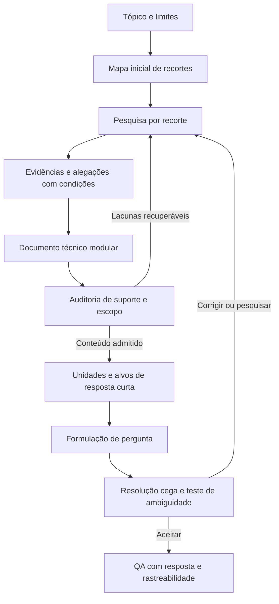

# Plano: pesquisa no corpus, documento auditável e QA de resposta curta

Versão de desenho: 19/10/2026. O motor e o notebook deste plano estão em `pipeline/qa_research/`. Este documento não é um relatório de uma pesquisa de produção já executada nem uma certificação humana das saídas.

## 1. Objetivo e decisão de arquitetura

Partimos de um tópico amplo e queremos explorar o conhecimento técnico que o corpus sustenta. O produto final é um conjunto de pares **pergunta objetiva–resposta curta**, com evidências e condições preservadas. Não haverá alternativas de múltipla escolha, questões de datasets externos nem questões de exemplo nos prompts.

A arquitetura terá duas fases distintas:

1. **Pesquisa e organização:** decompor o tópico, investigar recortes, recuperar documentos, escrever e auditar um documento técnico amplo.
2. **Construção de QA:** extrair unidades verificáveis desse documento, consultar seus trechos originais, escolher um alvo de resposta e só então formular e validar a pergunta.

O documento amplo terá liberdade de exposição: pode explicar mecanismos, comparar resultados e registrar controvérsias. Essa liberdade não autoriza acrescentar informações sem sustentação. A geração de QA será mais restritiva que a redação do documento: uma seção útil para compreensão pode não permitir nenhuma pergunta curta suficientemente determinada.

O documento e o registro de alegações serão produtos sincronizados. **Uma citação a um texto gerado não substitui uma evidência original.** Cada unidade candidata de QA terá uma cadeia explícita: pergunta → alvo de resposta → alegação → evidência → documento do corpus.



## 2. Como construir os recortes de Produtos químicos

O tópico contém três eixos que precisam aparecer no planejamento:

| Eixo | Elementos iniciais extraídos do escopo fornecido |
| --- | --- |
| Serviço ou sistema | Processamento do óleo; água produzida; água do mar para injeção; SRU; desaeração; tratamento do gás; sistemas topside e subsea |
| Fenômeno ou família | Emulsões; espuma; hidratos; incrustação; corrosão; depósitos; crescimento microbiológico; MEG; produtos descobertos na pesquisa |
| Decisão ou competência | Seleção; aplicação; dosagem; armazenamento; manuseio; monitoramento de desempenho; compatibilidade |

Esses eixos são uma grade de cobertura, não um produto cartesiano a preencher. Nem toda combinação existe ou interessa. O planejador propõe recortes com uma justificativa de pertinência e consultas de pesquisa; o corpus confirma, restringe ou desdobra cada proposta.

Um recorte precisa descrever um **problema delimitado**, e não apenas nomear um produto. Por exemplo, “MEG” é uma entidade; “papel do MEG na prevenção de hidratos em uma condição operacional documentada” é uma investigação. Essa formulação ainda não afirma qualquer condição ou desempenho que não tenha sido encontrado.

| Recorte inicial de pesquisa | Dimensões que busca cobrir | O que precisa ser descoberto |
| --- | --- | --- |
| Tratamento químico e desaeração da água de injeção | Água do mar; oxigênio; aplicação e monitoramento | Finalidade de cada etapa, limitações e indicadores descritos |
| Compatibilidade de produtos usados conjuntamente | Corrosão; incrustação; compatibilidade | Quais combinações foram testadas e sob quais condições |
| Avaliação de desemulsificantes | Processamento do óleo; emulsões; seleção e desempenho | Critérios de ensaio, variáveis e resultados efetivamente relatados |
| Controle microbiológico | Topside/subsea quando documentado; biocidas; desempenho | Populações avaliadas, método de monitoramento e contexto de aplicação |
| MEG e prevenção de hidratos | Gás; hidratos; seleção, aplicação e dosagem | Relações e valores com condições suficientes, quando existentes |
| Produtos empregados em SRU | Água de injeção; SRU; aplicação e compatibilidade | Produtos e restrições pertinentes ao processo encontrado |
| Armazenamento e manuseio | Produtos identificados na pesquisa; operação | Instruções atribuíveis ao produto, documento, edição e aplicação |

Esses são caminhos de busca propostos, não afirmações técnicas de que qualquer produto serve para qualquer sistema.

### Expansão adaptativa

Cada pesquisador pode propor um recorte filho quando encontrar uma distinção material: outro processo, mecanismo, condição de ensaio, incompatibilidade, indicador ou família de produtos. A proposta deve apontar a evidência que motivou a expansão e sua relação com o tópico.

O coordenador admite expansões pertinentes, une recortes redundantes e prioriza lacunas. Descobrir mais um sinônimo não justifica um novo recorte. Encontrar uma condição que muda a resposta pode justificar. Recortes sem evidência suficiente permanecem como lacunas; não são preenchidos pela memória geral do modelo.

O mapa registra, por recorte: origem, pai, termos e sinônimos, consultas realizadas, documentos distintos consultados, alegações admitidas, divergências e estado de cobertura. Os estados devem distinguir `planejado`, `pesquisado_com_suporte`, `pesquisado_sem_suporte`, `parcial`, `conflitante` e `pendente_por_orcamento`.

## 3. Pesquisa multiagente e recuperação

Os agentes são papéis com entradas e saídas limitadas. Eles podem utilizar o mesmo modelo em chamadas distintas; isso não os torna verificadores estatisticamente independentes.

| Papel | Responsabilidade | Saída verificável |
| --- | --- | --- |
| Coordenador | Interpretar escopo, distribuir recortes, consolidar cobertura e controlar orçamento | Plano, fila de trabalho, decisões de expansão e lacunas |
| Pesquisadores de recorte | Formular consultas, ler trechos com contexto, propor alegações e escrever seções | Consultas, evidências, alegações, seção e novas necessidades de busca |
| Auditor | Voltar aos originais e avaliar suporte, condições, atribuição e divergências | Decisão por alegação e solicitações de correção ou pesquisa |
| Extrator e autor de QA | Escolher unidades elegíveis, fixar alvo curto e formular pergunta | QA candidata com vínculo às alegações e aos originais |
| Revisor de QA | Resolver sem gabarito e procurar respostas distintas plausíveis | Resposta independente, evidências e diagnóstico de ambiguidade |

A investigação começa por consultas com vocabulário do tópico e pode incorporar termos encontrados no corpus. Consultas em português e em outros idiomas devem ser registradas. O modelo pode traduzir termos de busca, mas uma tradução não conta como evidência.

A recuperação deve combinar correspondência lexical e, quando disponível e configurada, similaridade semântica. Uma primeira versão lexical precisa declarar essa limitação; não deve ser chamada de busca híbrida sem um componente semântico real. Depois da recuperação, a seleção considera pertinência, contexto suficiente, diversidade documental e redundância, sem substituir o escore de busca por um suposto índice de verdade.

O pesquisador não lê apenas uma frase isolada. Título, hierarquia de seção e vizinhança conhecida ajudam a resolver siglas, sujeitos, condições e referências a tabelas. Contexto vizinho só pode ser agregado quando a identidade e os limites do documento forem conhecidos. Em coleções de fragmentos de origem parcialmente desconhecida, não se deve unir textos apenas porque aparecem próximos no arquivo.

Se a explicação requer condições ou resultados ausentes no trecho, o agente formula uma nova consulta específica. A rodada termina quando as necessidades foram respondidas, a recuperação não acrescenta evidências materiais ou o orçamento acaba. A razão fica registrada. Saturação de uma busca não prova exaustividade do corpus.

## 4. Extração para corpus científico heterogêneo

Não classificaremos uma tese inteira como opinião nem um artigo inteiro como verdade. A unidade de avaliação é a alegação com seu contexto e suporte.

Para cada alegação, preservar:

- Uma proposição delimitada e sua modalidade: “pode”, “foi observado” e “deve” têm significados distintos.
- Tipo de conteúdo: princípio descrito, resultado experimental, procedimento, definição, recomendação/opinião, hipótese, obrigação normativa ou síntese.
- Condições pertinentes: sistema, material, população, concentração, temperatura, pressão, duração, método, comparador e critério de desempenho, conforme o trecho.
- Valores, unidades, intervalos e incertezas sem completar campos ausentes.
- Texto literal original, identificador do documento e do trecho; página e seção apenas quando disponíveis.
- Idioma original e, quando útil, tradução de trabalho separada da citação.
- Atribuição: resultado do próprio documento ou afirmação que ele atribui a outra fonte.
- Limites, conflito, dados ausentes e possível aplicabilidade ao escopo FPSO.

Um formato conceitual simples é suficiente:

```text
alegacao_id
recorte_id
proposicao
tipo_epistemico
condicoes
valores_e_unidades
evidencias[documento_id, trecho_id, citacao_literal, localizacao]
atribuicao_e_dependencia
limites_e_divergencias
estado_de_auditoria
elegibilidade_para_qa
```

O texto original permanece imutável. Traduções, normalização de símbolos e conversões de unidade ficam em campos derivados, com operação e proveniência. Uma tabela cujo cabeçalho foi perdido ou um valor cuja unidade não é identificável não deve originar uma pergunta numérica aprovada.

Um resultado experimental específico permanece específico. Uma concentração usada em uma dissertação não se transforma em dosagem recomendada para FPSOs. Uma regra estrangeira permanece vinculada a sua jurisdição, edição e escopo. Se esses dados não estiverem disponíveis, a lacuna deve impedir sua apresentação como requisito operacional vigente.

Uma tese que cita um artigo e outra tese que repete a mesma citação não fornecem automaticamente duas confirmações independentes. Registramos a dependência conhecida; não afirmamos ter consultado o artigo original quando só vimos a atribuição secundária.

## 5. Documento amplo com liberdade de redação e auditoria

O documento técnico será dividido em módulos correspondentes aos recortes consolidados. Cada módulo apresenta contexto, mecanismos, critérios ou resultados disponíveis, condições de aplicação, divergências e lacunas. A amplitude decorre da cobertura sustentada; não do comprimento ou de uma meta de palavras.

O escritor pode organizar a narrativa e comparar evidências. Afirmações materiais devem apontar para os IDs das alegações; essas, por sua vez, apontam para os originais. Uma síntese nova pode ser proposta, mas deve ser identificada como síntese e ter suas premissas verificadas antes de entrar na parte admitida do documento.

A auditoria tem dois níveis:

1. **Integridade e contrato:** identificadores existentes, citações presentes nos originais, campos obrigatórios, limites do documento e referências consistentes.
2. **Suporte semântico:** os originais sustentam a proposição inteira, inclusive qualificadores, comparações e condições? Há generalização, omissão relevante ou transformação de opinião em fato?

Encontrar a citação literalmente comprova integridade textual; não comprova que a alegação é sustentada. As decisões por alegação serão, no mínimo, `suportada_no_contexto`, `nao_suportada`, `contradita`, `ambiguamente_suportada` ou `requer_contexto`.

Uma alegação pode estar corretamente atribuída como opinião e ainda assim ser inadequada para QA factual. Auditoria de fidelidade e elegibilidade para QA são decisões diferentes.

Os trechos rejeitados não devem reaparecer silenciosamente na narrativa final. Correções exigem nova avaliação da alegação afetada. O documento final informa o que foi efetivamente consultado, suas lacunas e o nível de revisão automática realizado; não declara revisão humana sem sua realização.

## 6. Do documento ao alvo de resposta e à pergunta

O gerador recebe um módulo, suas alegações admitidas e os originais correspondentes. Não é necessário reenviar o documento inteiro em todas as chamadas. Uma etapa de extração identifica unidades que comportem uma resposta curta determinada.

**Primeiro fixa-se o que será respondido; depois escreve-se a pergunta.** Esta é uma decisão de desenho nossa, voltada ao objetivo deste projeto. Para cada unidade:

1. Escolher uma relação sustentada e pertinente ao programa.
2. Definir um único alvo: substância, fenômeno, finalidade, propriedade, parâmetro, condição, valor com unidade ou relação causal curta.
3. Registrar a resposta canônica e as formas equivalentes sustentáveis.
4. Identificar todas as condições necessárias para determinar esse alvo.
5. Formular uma pergunta autossuficiente, com essas condições e sem entregar o alvo.
6. Excluir unidades que exijam opinião, discussão abrangente, vários objetivos ou preenchimento de conhecimento ausente.

A resposta deve, por padrão, ser uma expressão ou uma frase curta, com limite configurável. O limite não justifica retirar uma unidade, ressalva ou condição necessária. Se a relação só puder ser respondida corretamente com uma explicação longa, ela não pertence ao lote atual de QA curta.

Questões de resultado localizado precisam identificar o estudo ou cenário suficientemente para que sua resposta seja determinada. Isso pode ser feito com uma descrição sucinta das condições ou com uma referência identificável. Remover a expressão “neste estudo” sem acrescentar seu contexto cria uma pergunta vaga.

Não haverá obrigação de usar múltiplos documentos ou raciocínio de várias etapas. A pesquisa pode exigir muitas fontes e resultar em uma pergunta curta sustentada por uma delas. Quando uma síntese entre fontes for necessária, todos os passos relevantes precisam ser sustentados e a resposta final ainda deve ser curta e determinada.

O prompt de autoria contém papel, tarefa, critérios, esquema, módulo, alegações e originais. Não contém pares QA de demonstração, dados de benchmarks ou exemplos externos. Os testes de software também não devem ser interpolados nos prompts de produção.

## 7. Verificação de resposta e ambiguidade

O teste cego recebe **a pergunta e as evidências originais**, sem resposta canônica, aliases ou explicação do autor. Isso mede se a resposta é recuperável e determinada no material disponível; não mede memorização do modelo sem contexto.

Uma etapa posterior compara a resposta obtida com o alvo. Não basta igualdade textual: sigla e nome expandido, forma flexionada e tradução inequívoca podem expressar a mesma resposta. Para números, valores, unidades e tolerância explicitamente admitida precisam coincidir.

Um adversário procura outra resposta semanticamente distinta que também satisfaça o enunciado nas evidências. Ele deve apresentar a resposta alternativa e o suporte, ou explicar a dimensão ausente que permite múltiplas interpretações. Produzir outro sinônimo do gabarito não demonstra ambiguidade.

Quando pertinente, uma busca complementar no corpus procura outra resposta ou um contexto conflitante. Não encontrar alternativa no orçamento disponível não demonstra inexistência universal de alternativas. A aceitação é relativa ao enunciado, às evidências e à verificação realizada.

| Verificação | Condição para aceitar |
| --- | --- |
| Suporte | Resposta inteira sustentada por originais e alegações admitidas |
| Determinação | Condições do enunciado delimitam o alvo sem respostas distintas plausíveis encontradas |
| Resolução cega | Solução independente equivalente ao alvo ou justificativa explícita para revisão |
| Forma | Uma pergunta, resposta curta, sem alternativas, sem referência deíctica vazia |
| Escopo | Pertinência ao tópico e ausência de generalização indevida |
| Integridade | IDs, citações, condições, valores e unidades consistentes |
| Novidade | Conhecimento avaliado acrescenta algo ao conjunto, além de reformulação textual |

Uma candidata ambígua é restringida e reavaliada, ou descartada. Uma candidata sem suporte volta à pesquisa, ou é descartada. O estado de reprovação precisa governar a exportação final; não pode existir apenas como comentário em um arquivo de avaliação.

## 8. Artefatos e critérios de conclusão

Uma execução deve preservar o plano e suas revisões, a cobertura, as consultas e seleções, as evidências originais utilizadas, o registro de alegações, a auditoria, o documento modular, as QA candidatas, os resultados de avaliação e as QA aceitas. Os nomes físicos dos arquivos podem variar; seus vínculos não.

As chamadas de modelo devem registrar modelo, configuração, versão do prompt, entradas referenciadas, custo ou uso disponível, tentativas e falhas. Cache e retomada precisam considerar o conteúdo das evidências e a versão das instruções. Alterar uma evidência ou corrigir uma alegação invalida os produtos dependentes afetados.

Uma execução sem API ou com modelos simulados pode verificar contratos, rastreabilidade, rejeição de citações inválidas, filtragem, retomada e exportação. Isso não deve ser relatado como teste da qualidade científica das saídas de um modelo real. Uma execução curta com modelo real será necessária para avaliar a pesquisa, a redação, a seleção de alvos e o comportamento dos revisores.

Mediremos cobertura da grade planejada, alegações sustentadas, lacunas, taxa de QA aceita, causas de rejeição, repetição de alvos e uso de recursos. Não calcularemos “percentual de todo o conhecimento do corpus” sem um denominador conhecido. Um número alto de perguntas não substitui diversidade de conhecimentos avaliados.

## 9. Fundamentos da literatura e adaptações nossas

| Fonte primária | O que ela oferece | Como foi usado neste desenho |
| --- | --- | --- |
| [AIM-SciQA, apêndice A](https://arxiv.org/html/2603.14257v1) | Extração de informação científica diretamente identificável, condições no enunciado e evidência literal na etapa inicial | Inspirou a unidade com evidência; aqui separamos alegação, alvo curto e pergunta. O artigo aborda também integração entre documentos, que não é obrigatória no nosso caso. |
| [OpenScholar, publicação e método](https://www.nature.com/articles/s41586-025-10072-4) e [código de prompts](https://github.com/AkariAsai/OpenScholar/blob/0e9b8fb912273d3dae39e593da86e4f6d3bf8de1/src/instructions.py) | Recuperação, síntese, feedback e novas consultas quando faltam informações | Inspirou a pesquisa por lacunas. A grade de recortes, a coordenação multiagente e o controle de cobertura são adaptações nossas. |
| [Claimify — Towards Effective Extraction and Evaluation of Factual Claims](https://aclanthology.org/2025.acl-long.348/) | Separar seleção, desambiguação e decomposição; não forçar uma interpretação quando o contexto não resolve a ambiguidade | Inspirou extrair proposições verificáveis preservando condições. O trabalho não valida automaticamente transferência de resultados experimentais para FPSOs. |
| [SciFact — Fact or Fiction: Verifying Scientific Claims](https://aclanthology.org/2020.emnlp-main.609/) | Verificação de alegações científicas com evidências de suporte ou refutação e justificativas | Inspirou auditar a relação entre alegação e evidência. Não importaremos seus exemplos nem assumiremos desempenho equivalente no domínio industrial. |

O inventário anterior de código permanece em [metodos_cientificos_codigo.md](pesquisa_geracao_qa_rag_2026_10_18/metodos_cientificos_codigo.md). Ele registra diferenças entre prompts publicados e implementações, incluindo um avaliador com acesso ao gabarito e uma exportação que não consultava seu resultado. O novo desenho evita essas duas falhas por contrato.

Esta composição é uma proposta de engenharia para nosso objetivo. Os artigos apoiam seus componentes, mas não demonstram que o pipeline composto já produz perguntas inequívocas ou conhecimento exaustivo. As verificações reduzem erros e tornam as limitações inspecionáveis; a qualidade final precisa ser observada em execuções reais.
