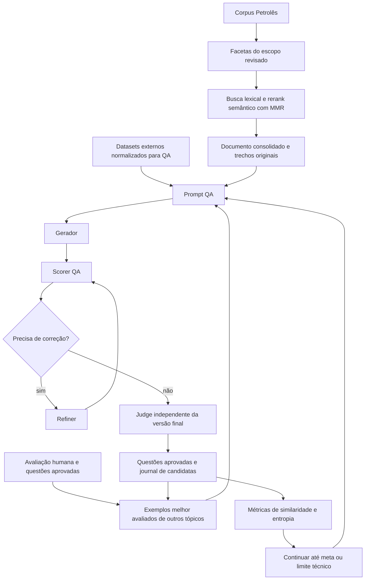

# PetroQuest QA — fase 4 completa

Esta fase adapta o motor da fase 3 para **pergunta e resposta**, preservando recuperação de domínio, exemplos avaliados, refinamento, Judge e entropia semântica. A fase 3 permanece intacta. As fases 4/5 anteriores estão em `pipeline/backup/pre_petroquest_qa_2026-10-10/`; a primeira implementação QA desta conversa também foi preservada em `pipeline/backup/pre_refatoracao_qa_2026-10-10/`.



## Fonte factual e recuperação

`domain.py` reutiliza `utils_fase3.py`: extração das facetas a partir das frases revisadas em `topicos.py`, varredura lexical streaming do corpus, rerank vetorial, MMR e consolidação dos trechos. O gerador e o Judge recebem os trechos originais e o documento consolidado. Cada resposta precisa de `evidence` com ID e citação literal de fonte. Arquivo e linhas de origem permanecem no journal.

Não há geração baseada apenas no título do tópico ou fallback quando o corpus/embeddings faltam. Subtópicos sem evidência são registrados em `cobertura_dominio.json` e no resumo. O corpus de vários GB continua fora do Git: use o Petrolês já instalado no servidor. A descoberta automática prefere a pasta `PetrolesCompleto` e usa `PetrolesHibrido` quando necessário; recomendamos caminho explícito para registrar exatamente a base do experimento.

## Exemplos melhor avaliados

- As vencedoras da avaliação humana da fase 2 continuam sendo extraídas por `seed_fase3.construir_banco_seed`. A margem de preferência e os votos ficam registrados; essa margem não é confundida com uma nota de qualidade absoluta.
- As aprovações sem ressalvas detectadas na revisão do especialista entram como candidatas a seed. Pareceres de repetição, erro técnico ou incompatibilidade de escopo ficam fora desse banco.
- Novas questões aprovadas pelo Judge com nota ≥0,85 podem entrar no pool. O peso relativo das seeds diminui conforme esse pool cresce, preservando a lógica da fase 3.
- O pool PetroQuest exclui **todo o tópico atual**, como solicitado. Os exemplos fornecem forma; somente o corpus recuperado fornece fatos.
- ARC-Easy, ARC-Challenge, Pirá, SQuAD 2.0, HotpotQA e BoolQ entram como QA. O ARC fornece pergunta e texto da resposta correta, sem alternativas; enunciados dependentes de opções são filtrados. São até 8 exemplos externos por lote e 4 exemplos PetroQuest por padrão.

## Scorer, Refiner e Judge

O Scorer determinístico foi adaptado para QA: referências a alternativas/passagens, respostas em forma de letra de gabarito, placeholders, extensão desnecessária, excesso de siglas e evidências ausentes ou inválidas. Até dois refinamentos são permitidos; o Scorer reavalia cada versão. Problemas não resolvidos permanecem rejeitados com diagnóstico.

O Judge avalia a **versão final**, separadamente do gerador/refinador, contra as fontes originais. Requer vereditos explícitos de correção técnica, suporte nas fontes, aderência ao escopo FPSO e pergunta autossuficiente. Pontua correção (0,40), clareza (0,20), completude da resposta (0,20) e relevância (0,20). A nota é calculada pelo código; aprovação exige ≥0,75. Notas, vereditos ou dificuldade ausentes/inválidos não aprovam a questão. A dificuldade julgada e a solicitada ficam separadas.

## Rodada observacional atual

**Cosine e parada por saturação ficam desligados por padrão.** A aprovação por qualidade técnica continua ativa. Similaridade, duplicatas exatas, diversidade lexical e sinais de saturação não provocam refinamento ou rejeição neste modo. Não há descarte oculto de duplicatas exatas.

Cosine continua sendo usado para recuperar/selecionar trechos do corpus; o filtro desligado é o de similaridade entre **questões**. Os limiares de 0,50/0,70/0,85/0,95 são comparados como decisões simuladas. Também são medidos cosine da pergunta e do par QA, máximos separados para seeds/geradas, Jaccard lexical, trigramas de caracteres e combinações. Os IDs dos vizinhos mais semelhantes ficam registrados.

A entropia principal é Shannon normalizada sobre **codebooks fixos treinados em chunks do domínio**, por tópico e subtópico, reutilizando a implementação da fase 3. Tags conceituais e entropia lexical são indicadores secundários. Cada rodada registra ganho de entropia, novos clusters, aceitação, distribuição de dificuldade e sinais que teriam disparado parada. As curvas consideram tanto candidatas quanto aprovadas para estudar o efeito do Judge.

A meta é **100 questões novas aceitas por tópico**, alternando subtópicos e dificuldades. Seeds não consomem a meta. Limites técnicos: 500 posições solicitadas ao gerador por tópico, 5.000 pedidos lógicos somados entre preparação/gerador/refinador/Judge e 3 falhas consecutivas. Pedidos HTTP de retry do backend não equivalem a novos pedidos lógicos. Meta, orçamentos e limites são configuráveis. Os filtros futuros só são ativados explicitamente por `--enable-cosine-filter` e `--enable-saturation-stop`.

Decisões simuladas permitem comparar cortes no conjunto observado; não simulam a trajetória de um experimento que tivesse descartado/refinado questões com outra política desde o início.

## Executar no servidor Petrobras

Na raiz do checkout, com `.env` Azure e certificado/gateway configurados como já previsto em `azure_openai_backend.py`:

```bash
git pull --ff-only origin dev
python -m pip install -r requirements.txt
python pipeline/qa_references/download_qa_examples.py --max-per-dataset 1000
python pipeline/fase_4/run_qa.py --list-topics
python pipeline/fase_4/run_qa.py --print-prompt
```

Para esta rodada, use uma **nova pasta**, preservando as questões da implementação anterior:

```bash
mkdir -p pipeline/fase_4/saida_qa_v2
nohup python -u pipeline/fase_4/run_qa.py \
  --corpus-dir /caminho/real/do/PetrolesCompleto \
  --deployment gpt-5-4-petrobras \
  --effort high \
  --limit-per-topic 100 \
  --observe-only \
  --output pipeline/fase_4/saida_qa_v2 \
  > pipeline/fase_4/saida_qa_v2/execucao.log 2>&1 < /dev/null &
```

O mesmo deployment e esforço são usados por padrão na preparação, no gerador, no refinador e no Judge. O backend não poderá remover `reasoning_effort` silenciosamente nesta fase: uma recusa desse parâmetro interrompe a etapa e fica registrada.

O teto mínimo de conclusão é 12.000 tokens em cada papel, incluindo preparação, para acomodar o raciocínio com esforço alto. É um limite de espaço para raciocínio e resposta; o consumo real é o informado pelo Azure.

Também são aceitos `--corpus-txt arquivo1.txt arquivo2.txt` ou `--corpus-zip corpus.zip`. Para preparar somente índices/codebooks, use `--prepare-only`; depois execute novamente com `--resume` para gerar. Para continuar uma geração QA v2 interrompida, repita os mesmos parâmetros com `--resume`. Execuções antigas sem suporte no domínio não são retomadas como QA v2. Não use a pasta da implementação anterior.

Dados do corpus, bancos de exemplos, prompts, modelo de embeddings e políticas possuem assinaturas/checkpoints. Alterações de fontes ou políticas exigem outra saída, para manter comparações interpretáveis. Sem `--resume`, uma pasta que já contém execução é recusada; arquivos não são apagados automaticamente.

## Saídas e curadoria

| Arquivo | Conteúdo |
|---|---|
| `questoes_qa.jsonl` | Aprovadas pelo fluxo técnico, com nota, dificuldade, evidência e proveniência |
| `pares_qa.jsonl` | Apenas pergunta e resposta, pronto para consumo QA |
| `candidatas_metricas.jsonl` | Journal completo: original, versões refinadas, Scorer, Judge, métricas, decisões simuladas e motivo de rejeição |
| `metricas_por_rodada.jsonl` | Entropia semântica, ganhos, cobertura, aceitação, similaridades e sinais de saturação |
| `resumo_topicos.json` / `.jsonl` | Volume, dificuldades julgadas, lacunas de domínio e motivo de término |
| `banco_seed_qa.jsonl` | Seeds com tipo de avaliação e proveniência humana |
| `external_examples_used.jsonl` | Snapshot dos exemplos externos com origem e licença |
| `seeds_especialista_e_geradas.jsonl` | Candidatas aprovadas pelo especialista e novas questões para curadoria |
| `run_config.json`, `state.json` | Versão, configuração, assinaturas e pedidos por papel, retomáveis |
| `dominio/` | Índices de recuperação, documentos consolidados, embeddings e codebooks |
| `eventos.jsonl` | Lotes originais e erros por etapa, incluindo uma interrupção no meio do lote |

O journal é a fonte da exportação: se houver interrupção entre journal e saída aceita, a retomada reconstrói a exportação sem duplicar IDs. Uma rodada interrompida fica preservada nos eventos e o número de rodada é reservado antes da chamada; a próxima rodada não reutiliza esse ID.

### Trazer resultados pelo GitHub

O transporte usado neste projeto é via GitHub, pela branch `dev`. A pasta de execução é ignorada no Git por padrão; adicione explicitamente os arquivos de auditoria. Execute na raiz do projeto no servidor, na branch `dev`, depois da geração:

```bash
git add -f -- pipeline/fase_4/saida_qa_v2/*.json pipeline/fase_4/saida_qa_v2/*.jsonl
git add -f -- pipeline/fase_4/saida_qa_v2/dominio/documentos/
git add -f -- pipeline/fase_4/saida_qa_v2/dominio/indices/facetas.jsonl
git diff --cached --stat
git commit -m "data: add PetroQuest QA observational results"
git push origin dev
```

Os globs do primeiro comando são expandidos pelo Bash do servidor e incluem os JSON/JSONL diretamente na pasta de saída. O corpus e os caches binários de embeddings continuam locais. As candidatas e as questões aprovadas já contêm os trechos originais usados, e os documentos consolidados são incluídos para análise.

No computador local, na raiz do projeto e na branch `dev`:

```powershell
git pull --ff-only origin dev
```

Se a pasta usada na geração foi outra, ajuste `saida_qa_v2` nos comandos. Registre cada execução posterior em uma pasta própria para preservar os resultados deste experimento.

Para arquivar a execução completa no servidor:

```bash
tar -czf petroquest-qa-v2-resultados.tar.gz pipeline/fase_4/saida_qa_v2
```

Leve a pasta completa para poder curar respostas junto com fontes, versões, notas e curvas. A revisão humana permanece necessária para avaliar o resultado do experimento.

## Notebook e verificação local

`petroquest_fase4_qa.ipynb` configura e executa o mesmo motor, mostra o prompt, os bancos de exemplos e as curvas. Não mantém uma segunda implementação da geração.

```bash
python -m unittest discover -s pipeline/fase_4/tests -v
```

Os testes usam clientes/embeddings simulados e um pequeno corpus real de fixture, sem custos Azure. Verificam: recuperação e rastreabilidade, refino antes do Judge, reprovação sem suporte/veredito, exemplares com avaliação, cota por tópico, continuidade com cosine/saturação altos, filtros apenas por ativação explícita, limites globais e retomada sem duplicar dados. Esses testes validam o fluxo; a qualidade das novas questões precisa ser medida na execução real.
