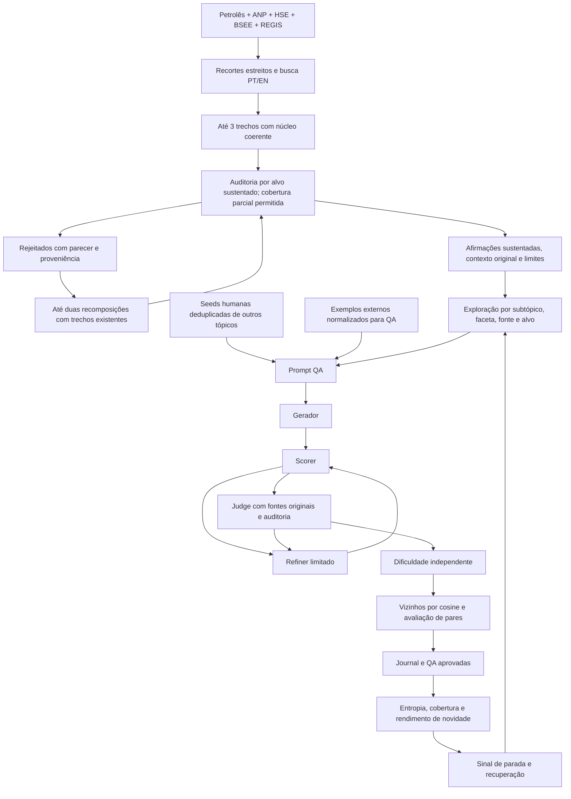

# PetroQuest QA v6

Geração de perguntas/respostas técnicas autossuficientes. Alternativas em standby. Notebook e CLI usam o mesmo motor.

**Rodada atual:** 10 trechos de cerca de 1.000 palavras por faceta → documento técnico composto por LLM → geração QA → Scorer/Refiner/Judge → dificuldade e métricas. Não há auditoria factual prévia bloqueante no modo composto. GPT‑5.4, effort `medium`; embeddings exclusivos Azure `embedding-3-large-global`.

**[Comandos atuais, acompanhamento e transporte dos resultados](EXECUCAO_QA_V6.md)** · **[Prompts para revisão](prompts_qa_v6.md)**

As seções e comandos QA v3/v4/v5 abaixo são históricos, especialmente a auditoria obrigatória. Não retome essas saídas com QA v6.

As versões anteriores estão preservadas: fases antigas em `pipeline/backup/pre_petroquest_qa_2026-10-10/`, primeira refatoração em `pre_refatoracao_qa_2026-10-10/` e código QA v2 em **`pipeline/backup/pre_qa_v3_2026-10-11/fase_4/`**. Resultados QA v2 e sua análise permanecem na pasta original. Uma execução v2 não pode ser retomada como v3.

## Fluxo anterior auditado (histórico)



### 1. Auditoria de fontes antes de gerar

O corpus factual passa a ser **Petrolês + ANP + HSE + BSEE + REGIS**, selecionado por `--corpus-manifest`. [Instalação e próxima execução](../domain_corpora/README.md) descreve coleta, testes e comandos prontos. O modo antigo com somente TXT continua disponível para reproduzir rodadas anteriores. A busca conjunta usa consultas PT/EN e cotas de candidatos por coleção. A montagem usa o conjunto único por faceta: **um mesmo contexto pode combinar vários corpora, sem funções fixas por coleção**. Preserva documento, página quando disponível, idioma e jurisdição por trecho. **Todos os documentos candidatos dos tópicos selecionados são auditados antes da primeira pergunta.**

O auditor recebe faceta, escopo e trechos originais. Avalia consistência técnica, condições da instalação/processo, compatibilidade com FPSO, transferibilidade, contradições e incerteza normativa. Rejeita transposições indevidas de refinaria, Spar, coleta urbana e outros contextos. Aprovação exige critérios explícitos, confiança ≥0,85 e afirmações sustentadas por citações literais verificadas pelo código.

Somente chunks autorizados permanecem no contexto. O documento do prompt é montado a partir das afirmações aprovadas, preservando **contexto original, aplicabilidade e limitações**; não existe uma segunda consolidação livre capaz de acrescentar fatos. Ausência de material adequado deixa o subtópico descoberto; não há geração pelo título nem adaptação silenciosa. Auditorias inválidas interrompem a preparação após duas respostas estruturais inválidas; reprovações factuais válidas são registradas como bloqueio.

A QA é respondível sem ler a fonte. A fonte sustenta fatos, mas não é apresentada ao respondente nem convertida em passagem de interpretação. Cenários só aparecem quando necessários à decisão técnica. A auditoria pelo modelo é uma avaliação estimada, não substitui a curadoria técnica humana.

### 2. Exploração e exemplos

- Cotas alvo de aprovadas por `(tópico, subtópico)` são distribuídas entre os subtópicos com fontes auditadas. Lacunas permanecem explícitas. Cotas são metas de balanceamento, não garantia quando existem bloqueios.
- Seleção prioriza cobertura de facetas/documentos; depois considera rendimento de novidade, exploração e sobreposição dos chunks recentemente usados. Não permanece na mesma faceta até a entropia saturar.
- Alvos de conhecimento vêm da auditoria, possuem IDs e são priorizados pelo menor uso. O lote padrão é **2 perguntas**, no máximo uma por alvo.
- Dificuldades solicitadas alternam **localmente em cada subtópico**, evitando sincronização com o ciclo global. Distribuições solicitada/inferida são separadas; o código não relabela uma pergunta para preencher uma cota de dificuldade.
- Seeds humanas mantêm avaliação/proveniência e passam por deduplicação semântica confirmada antes de serem exemplos. O few-shot PetroQuest exclui todo o tópico atual. Novas questões entram nos exemplos somente quando aprovadas, nota ≥0,85 e novidade útil estimada.
- ARC Easy/Challenge, Pirá, SQuAD 2.0, HotpotQA e BoolQ fornecem referências de **formato**. No ARC, somente pergunta e texto da opção correta permanecem; comandos dependentes de alternativas são filtrados. O banco usa amostragem por lote, com até 8 exemplos externos e 4 PetroQuest.

### 3. Scorer, Refiner e Judge

O Scorer verifica formato QA, ausência de alternativas/passagens, siglas, extensão, placeholders, target_id e evidências literais. Há até **2 refinamentos no total por candidata**, incluindo correções solicitadas pelo Judge. Cada versão é reavaliada; problemas persistentes reprovam.

O Judge recebe a QA final, escopo, material auditado e **trechos originais**. Exige razões para oito verificações: correção técnica, suporte factual, escopo/alvo, autonomia, compatibilidade com contexto, ausência de generalização indevida, validade normativa e cobertura das afirmações. Lista suporte por afirmação da resposta. Falhas factuais/de contexto não podem ser maquiadas por refinamento.

Pesos: correção 0,40, clareza 0,20, completude 0,20 e relevância 0,20. Aprovação exige todos os critérios, nota ≥**0,85**, correção ≥**0,90** e relevância ≥**0,85**. Vereditos malformados não aprovam nem contam como evidência científica de saturação. Esses valores são parâmetros iniciais, a calibrar com curadoria.

### 4. Dificuldade adaptada do backup

Origem: `pipeline/backup/pre_petroquest_qa_2026-10-10/fase_4/avaliacao_dificuldade_azure.ipynb`.

O avaliador independente recebe pergunta/resposta, tópico/subtópico, **sem o nível solicitado e sem o documento**. Quatro dimensões de 1 a 3: integração de conhecimento, cadeia de raciocínio, demanda cognitiva e especificidade técnica. A dimensão de distratores foi removida. A média define fácil ≤1,66; média ≤2,33; difícil acima disso. Difícil requer também raciocínio e demanda cognitiva ≥2. Extensão, cenário artificial e siglas não elevam dificuldade sozinhos. Notas, razões e confiança ficam no journal; baixa confiança sinaliza revisão humana.

Os prompts completos estão em `prompts_qa_v4.md` e podem ser impressos sem chamada Azure:

```bash
python pipeline/fase_4/run_qa.py --print-prompt
python pipeline/fase_4/run_qa.py --print-source-audit-prompt
python pipeline/fase_4/run_qa.py --print-judge-prompt
python pipeline/fase_4/run_qa.py --print-difficulty-prompt
```

### 5. Similaridade e entropia

Embeddings cobrem o texto inteiro com **Azure `embedding-3-large-global`, em 3.072 dimensões**. Entradas com mais de 8.192 tokens usam janelas sobrepostas, agregadas com média ponderada e normalização. Deployment, modelo declarado, API version, tokenizer, dimensões e diagnósticos ficam registrados, com cache SQLite separado dos vetores locais anteriores. **A escala de cosine muda**, logo o corte 0,85 é inicial e precisa de nova calibração.

Cosine ≥0,85 recupera até 8 vizinhos para uma avaliação de **pares pergunta/resposta** pelo modelo. A avaliação distingue redundância, sobreposição parcial, questões distintas e incerteza, considerando objetivo, condições e resposta essencial. O modelo não recebe o cosine para decidir. Só redundância confirmada com confiança ≥0,90 autoriza o filtro opcional. Perguntas normalizadas idênticas são marcadas deterministicamente; respostas divergentes ficam para revisão.

A base decisional contém seeds deduplicadas e aprovadas consideradas novidades úteis. Rejeitadas e repetições aceitas no modo observacional não alimentam essa base. Além dela, `metrics_by_baseline` mede separadamente contra seeds, todas as aprovadas e rejeitadas anteriores, exclusivamente para diagnóstico. Incertezas não viram evidência de ausência de novidade. As candidatas continuam todas no journal.

Entropia Shannon normalizada usa codebooks fixos treinados apenas nos chunks **auditados** do domínio, por tópico/subtópico. Também se registram cosine de Q, resposta e QA, Jaccard, trigramas, diversidade lexical e decisões simuladas. Há curvas sobre aprovadas e novidades úteis. Codebooks pequenos são marcados como pouco confiáveis. Entropia não decide sozinha a parada.

### 6. Parada robusta e recuperação

Por subtópico, requer:

1. Pelo menos 12 candidatas mensuráveis e cobertura de ≥50% dos documentos e facetas auditados.
2. **Duas janelas completas e disjuntas de 30 candidatas mensuráveis**, ambas com rendimento de novidade útil ≤10% e nenhum novo alvo útil.
3. Rodada de recuperação com outras fontes/alvos: pelo menos 12 candidatas mensuráveis e dois documentos distintos, quando disponíveis.
4. Se aparecer novidade útil na recuperação, retoma exploração e exige nova observação. Se não aparecer, distingue saturação de bloqueio de qualidade.

Uma falha de API, resposta malformada ou problema de Scorer não demonstra saturação. O tópico só recebe sinal de encerramento quando todos os subtópicos cobertos estiverem fechados; bloqueio de qualidade tem motivo separado. Limites de orçamento e falta de fonte são encerramentos operacionais, não conclusão de saturação.

**Nesta coleta de 100 por tópico, parada e filtros permanecem desligados.** Continuamos explorando até depois de um sinal para observar novidades tardias. Com essa amostra alguns subtópicos não terão duas janelas completas: isso significa evidência insuficiente. Os limiares não estão calibrados ainda.

```bash
python pipeline/fase_4/replay_stopping.py --output pipeline/fase_4/saida_qa_v3_medium
```

O replay compara janelas 12/20/30, paciências 2/3 e coberturas 50/75/100%, contando novidade após sinais. Não reproduz como a geração teria mudado sob outra seleção. Ativação futura explícita: `--enable-saturation-stop` e/ou `--enable-redundancy-filter`. O antigo filtro puramente numérico `--enable-cosine-filter` também é explícito, mas não é a política recomendada de redundância confirmada.

## Enviar o código e executar no servidor Petrobras

A próxima rodada com **contextos que podem combinar os cinco corpora** usa o instalador e `--corpus-manifest` descritos em [pipeline/domain_corpora/README.md](../domain_corpora/README.md), com saída nova `saida_qa_v4_azure_large_medium`. Os comandos abaixo documentam a versão anterior; use o guia referido para a QA v4.

Na raiz do projeto local, branch `dev`, revise as alterações antes de publicar. Este comando inclui o backup do código e não inclui datasets, credenciais ou resultados:

```powershell
git add -- pipeline/fase_4/*.py pipeline/fase_4/README.md pipeline/fase_4/prompts_qa_v3.md pipeline/fase_4/petroquest_fase4_qa.ipynb pipeline/backup/pre_qa_v3_2026-10-11/
git diff --cached --stat
git commit -m "feat: audit sources and balance PetroQuest QA exploration"
git push origin dev
```

No servidor, na raiz do checkout, com `.env`, certificado/gateway Azure já configurados:

```bash
git pull --ff-only origin dev
python -m pip install -r requirements.txt
python pipeline/qa_references/download_qa_examples.py --max-per-dataset 1000
mkdir -p pipeline/fase_4/saida_qa_v3_medium
nohup python -u pipeline/fase_4/run_qa.py \
  --corpus-txt /caminho/real/arquivo1.txt /caminho/real/arquivo2.txt \
  --deployment gpt-5-4-petrobras --effort medium \
  --limit-per-topic 100 --batch-size 2 --observe-only \
  --output pipeline/fase_4/saida_qa_v3_medium \
  > pipeline/fase_4/saida_qa_v3_medium/execucao.log 2>&1 < /dev/null &
```

Substitua os caminhos pelos **dois TXT reais** usados na execução anterior. Pode usar `--corpus-dir /pasta/real` ou `--corpus-zip /arquivo.zip` em vez de `--corpus-txt`. Não existe exigência de ser o Híbrido; mantenha a mesma escolha para comparação.

Todos os sete papéis usam esse deployment/effort por padrão: preparação, auditor, gerador, refinador, Judge, dificuldade e redundância. [GPT‑5.4 suporta effort medium](https://developers.openai.com/api/docs/models/gpt-5.4); a disponibilidade do deployment depende do ambiente Petrobras. Remoção silenciosa de effort pelo backend é detectada e bloqueia continuidade.

Limites: 100 **novas aprovadas** por tópico, até 1.000 posições solicitadas ao gerador por tópico, 5.000 pedidos lógicos globais e três falhas consecutivas. Seeds não consomem a meta. Retries HTTP do backend não são novos pedidos lógicos. Limite de conclusão mínimo 12.000 tokens acomoda raciocínio e resposta; tokens informados nas respostas e duração são registrados por papel. Respostas sem usage e falhas HTTP não permitem recuperar consumo completo; os registros não equivalem à fatura. A auditoria adiciona chamadas e tempo; medium não garante execução total mais rápida que o fluxo antigo.

Para preparar somente fontes/índices/auditorias, adicione `--prepare-only`. Depois repita os mesmos argumentos com `--resume` e sem `--prepare-only`. Na retomada, auditorias válidas são reutilizadas; versões, fontes, exemplos e políticas precisam coincidir. Para continuar uma interrupção, repita os argumentos com `--resume`. Para mudar política use nova saída. Orçamentos técnicos podem ser ampliados na retomada.

## Saídas e transporte pelo GitHub

| Arquivo | Conteúdo |
|---|---|
| `questoes_qa.jsonl` / `pares_qa.jsonl` | Aprovadas com metadados / somente pergunta e resposta |
| `candidatas_metricas.jsonl` | Original, refinos, Scorer, Judge, dificuldade, redundância, fontes e métricas |
| `auditorias_contexto.jsonl`, `dominio/auditorias/` | Pareceres completos de documentos aprovados e bloqueados |
| `cobertura_dominio.json` | Documentos/facetas aprovados e lacunas por subtópico |
| `metricas_por_rodada.jsonl` | Curvas, seleção, cobertura, recuperação e sinais de parada |
| `resumo_topicos.json` / `.jsonl` | Aprovação, novidade, dificuldade, lacunas e motivo de encerramento |
| `banco_seed_qa.jsonl`, `seeds_deduplicadas.jsonl` | Banco humano com proveniência, após deduplicação |
| `external_examples_used.jsonl` | Snapshot externo com origem/licença |
| `chamadas_modelo.jsonl` | Deployment, effort, tokens efetivos e falhas por papel |
| `run_config.json`, `state.json`, `eventos.jsonl` | Versões, assinaturas, orçamento, checkpoint e lotes brutos |
| `dominio/documentos/`, `dominio/indices/facetas.jsonl` | Conteúdo auditado utilizado e facetas |
| `analise_parada/replay.json` / `.csv` | Comparação posterior dos sinais na trajetória observada |

Depois da geração, no servidor, branch `dev`:

```bash
python pipeline/fase_4/replay_stopping.py --output pipeline/fase_4/saida_qa_v3_medium
git add -f -- pipeline/fase_4/saida_qa_v3_medium/*.json pipeline/fase_4/saida_qa_v3_medium/*.jsonl
git add -f -- pipeline/fase_4/saida_qa_v3_medium/dominio/documentos/ pipeline/fase_4/saida_qa_v3_medium/dominio/auditorias/
git add -f -- pipeline/fase_4/saida_qa_v3_medium/dominio/indices/facetas.jsonl pipeline/fase_4/saida_qa_v3_medium/analise_parada/
git diff --cached --stat
git commit -m "data: add PetroQuest QA v3 medium observational run"
git push origin dev
```

No computador local: `git pull --ff-only origin dev`. Os globs são expandidos pelo Bash do servidor. Corpus, `.env` e caches binários não entram nesses comandos. Cada candidata traz trechos originais; documentos e auditorias complementam a curadoria. Preserve uma pasta por experimento.

## Notebook

`petroquest_fase4_qa.ipynb` permite configurar, baixar exemplos, imprimir prompts, preparar/auditar, inspecionar pareceres, gerar e analisar as curvas. Células de preparação/geração usam Azure e têm custo. O código foi inspecionado quanto a sintaxe e imports; a validação factual e a calibração dependem da próxima coleta e revisão humana.
