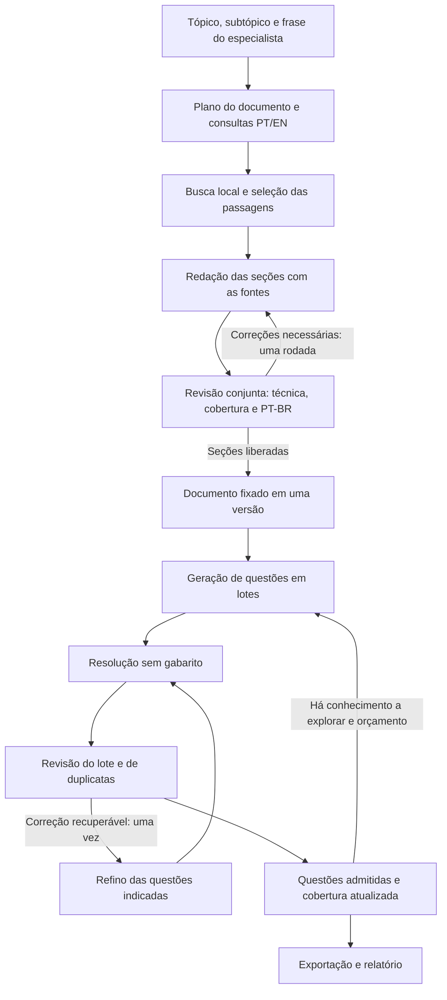

# Plano de reimplementação do fluxo de contexto e questões

Estado: proposta de arquitetura, anterior à implementação.

## 1. Objetivo

Gerar um documento técnico em português brasileiro por subtópico e, a partir dele,
um conjunto variado de perguntas abertas com respostas objetivas. A geração deve
ser compreensível, retomável e ter custo limitado. A qualidade deve ser verificada
por revisões que tomem decisões úteis sobre conjuntos de texto ou questões.

A nova geração será implementada em módulo próprio. Não chamará o Runner documental
anterior nem herdará seus ciclos internos. O acervo instalado, seus manifestos e a
busca local continuam sendo recursos de entrada.

## 2. Entrada e regras permanentes

- Entrada: tópico, subtópico e frase integral do especialista, lidos do cadastro.
- Um documento por subtópico. Seções são organização editorial desse documento.
- Português brasileiro, terminologia profissional do Brasil e contextualização
  em óleo, gás e FPSOs quando pertinente ao escopo.
- Fontes inglesas participam da busca e da fundamentação. Não se convertem
  recomendações estrangeiras em requisitos brasileiros.
- Texto técnico autônomo: conceitos, mecanismos, condições, critérios e consequências.
- Referências, evidências, complementos declarados e pareceres ficam em auxiliares.
- Complementação conceitual é permitida e declarada internamente. Números operacionais,
  dosagens, normas e resultados empíricos exigem suporte verificável.
- Preservar as classes conceito, mecanismo, consequência, diagnóstico, decisão e
  procedimento, além das marcas cenário e composição simples/composta.
- Questões existentes podem orientar a forma. Sua leitura deve ser explícita e
  ter origem registrada; exemplos nunca são suporte factual. Não baixar nem
  modificar datasets externos de questões.

## 3. Fluxo principal

As setas de correção têm limites explícitos; não reiniciam livremente o fluxo.

## 4. Construção do contexto

### Planejar uma vez

Uma chamada produz o sumário, um checklist dos pontos solicitados pelo especialista
e consultas PT/EN para cada seção. Cada ponto do checklist conserva sua ligação
literal com a frase original. O revisor também recebe a frase inteira, para poder
identificar omissões do próprio planejamento.

A referência do piloto é organizar o escopo em aproximadamente quatro a seis seções;
isso não autoriza cortar partes da frase para caber em uma quantidade fixa. Seções
podem conter subseções. Não haverá uma matriz obrigatória de todos os produtos,
sistemas e classes de questão.

### Buscar e selecionar em código

Executar os dois idiomas na busca local e combinar seus resultados. Remover passagens
repetidas e distribuir a seleção entre documentos pertinentes. Começar com seis a
oito passagens úteis por seção, com limite de tamanho total da entrada.

Passagens e documentos são contagens diferentes. A origem, o idioma e a localização
disponível devem acompanhar cada passagem. Não haverá chamadas de leitura de seis
em seis passagens para produzir um resumo intermediário.

### Ler e redigir na mesma chamada

O redator recebe o escopo integral, o sumário e as passagens da seção. Escreve a seção
completa e devolve, separadamente, as referências utilizadas e os complementos
conceituais. Tamanho de seção e orçamento de saída devem permitir uma resposta completa.

O controlador reúne as seções. Não haverá a subdivisão obrigatória em oito pequenos
blocos, nem auditoria individual de cada parágrafo.

### Fazer uma revisão conjunta

Um revisor recebe o documento, a frase do especialista, o checklist e as evidências
necessárias para verificar o conteúdo. Avalia correção técnica, suporte, condições,
coerência entre seções, repetições e português brasileiro na mesma etapa.

O parecer deve ser curto e acionável: seção/ponto afetado, problema e correção
necessária. Quando houver uma omissão relevante, pode sugerir uma consulta adicional,
executada localmente antes da correção. Corrigem-se somente as seções indicadas e
ocorre uma revisão final. Há no máximo uma rodada de correção documental.

O pacote de revisão tem orçamento explícito de entrada. Se o documento exceder a
capacidade configurada, a revisão usa grupos de seções completas e uma checagem de
coerência conjunta; o limite não pode cortar fontes ou partes do escopo silenciosamente.

### Fixar uma versão utilizável

O resultado pode ser completo, parcial ou sem conteúdo liberado. Uma seção com erro
factual não resolvido fica fora da entrada de QA. Uma falha operacional isolada não
invalida automaticamente seções revisadas. Conflitos entre seções impedem a liberação
das partes afetadas. O documento limpo reúne somente seções liberadas, e o relatório
registra os pontos ausentes. Sem nenhuma seção liberada, não se inicia QA.

Durante a geração das questões, essa versão do documento permanece fixa. Lacunas
encontradas depois ficam registradas para uma próxima versão documental.

## 5. Geração de questões

### Planejar e escrever o lote na mesma chamada

Gerar até oito candidatas por chamada, explorando pontos ainda pouco representados.
Cada candidata traz pergunta, resposta, classe, composição, conhecimento avaliado e
fundamento no documento. Isso substitui as etapas separadas de extração de unidades,
auditoria de unidades, planejamento de alvos e autoria individual.

O autor recebe o contexto pertinente, a frase original, um resumo da cobertura e
as questões já admitidas. Os exemplos curados são poucos e servem à forma da escrita.
Não há obrigação de produzir seis perguntas sobre cada conhecimento. Uma composta
precisa combinar relações de maneira necessária, mesmo que estejam na mesma seção.

### Resolver o lote sem o gabarito

Uma chamada separada recebe apenas os enunciados e o contexto pertinente. Não recebe
respostas esperadas, classes pretendidas ou exemplos. Devolve respostas e possíveis
ambiguidades. Um deployment diferente pode ser utilizado, mas isso não comprova
independência estatística entre os modelos.

### Revisar e deduplicar o lote

Uma chamada recebe candidatas, resoluções, contexto e um inventário compacto das
questões já admitidas. Verifica fundamento, correção, autonomia do enunciado, classe,
ausência de pistas, linguagem brasileira e duplicação dentro e entre lotes.

Duplicação significa avaliar a mesma demanda sobre o mesmo conhecimento e condições;
compartilhar assunto não basta. Duplicatas textuais são filtradas em código antes
da chamada. O inventário compacto completo deve caber no orçamento do piloto; o
controlador reduz o tamanho do lote quando necessário.

Cada questão recebe uma decisão: admitir, corrigir, descartar ou registrar lacuna
documental. Dúvida técnica não resolvida impede admissão. Questões admitidas pelo
modelo continuam sujeitas à avaliação do especialista.

### Refinar somente as recuperáveis

Uma chamada corrige, em lote, as questões indicadas, preservando conhecimento,
classe e fundamento. As modificadas são novamente resolvidas e revisadas.
Questões já admitidas não passam por essa repetição. Há uma única rodada de refino;
o refinador não inventa conteúdo para preencher lacunas do documento.

## 6. Parada e quantidade no piloto

| Parte | Regra proposta |
|---|---|
| Contexto | Uma busca/redação/revisão inicial e no máximo uma rodada de correção |
| Questões | Meta inicial de 40 admitidas e exploração dos pontos avaliáveis prioritários |
| Lotes | Até 8 candidatas novas por lote, no máximo 12 lotes: até 96 candidatas novas |
| Refino | Uma rodada por candidata recuperável; não cria uma nova candidata para a contagem |
| Saturação | Dois lotes consecutivos sem novas questões admitidas, após percorrer as seções elegíveis |
| Orçamento | Até 120 tentativas externas no piloto, contando falhas e reparos |

A geração para quando alcançar meta e cobertura prioritária, atingir um limite ou
constatar saturação. Pode terminar abaixo de 40; o relatório explica o motivo.
Cobertura é apresentada por pontos da frase, seções e classes, com os impedimentos
registrados. Não se afirma cobertura integral do domínio nem se força uma porcentagem
sobre um inventário artificial de unidades. Esses limites são hipóteses do piloto.

Com seis seções e oito lotes, sem correções ou falhas, a previsão estrutural é:
uma chamada de planejamento + seis de redação + uma de revisão + 24 de QA =
**32 chamadas principais para 64 candidatas**. Isso não prevê quantas serão admitidas
nem garante duração. Preflight de disponibilidade e eventuais revisões divididas
devem aparecer separadamente na contagem real.

## 7. Modelos e controle de execução

Proposta inicial usando os nomes de deployments já presentes no projeto, sujeita à
verificação de disponibilidade e medição no piloto:

| Trabalho | Configuração inicial |
|---|---|
| Planejamento e consultas | `gpt-5-4-petrobras:low` |
| Redação, autoria de QA e refino | `gpt-5-4-petrobras:medium` |
| Revisão documental e revisão de QA | `gpt-5-4-petrobras:high` |
| Resolução sem gabarito | `gpt-5-petrobras:medium` |

O controlador terá uma única camada de retentativas, com no máximo duas tentativas
externas por chamada lógica. Truncagem usa a tentativa restante com orçamento maior;
erro transitório usa espera curta e repetição. O limite é compartilhado entre os
motivos de falha. Não há fallback silencioso de modelo ou aprovação automática.

Orçamentos de entrada/saída variam por trabalho e são explícitos na configuração.
Para revisão, a proposta inicial é solicitar 16.000 tokens de saída e usar 32.000
na tentativa restante em caso de truncagem, sujeito à disponibilidade do deployment.
Esses valores são limites solicitados, não previsão de consumo. O parecer de
revisão é compacto; a saída não copia documento e fontes novamente.
O piloto começa com duas chamadas simultâneas. Prazo total de requisição e cancelamento
devem ser tratados pelo cliente, além do timeout de rede.

O terminal informa etapa, seção/lote, tentativa, tempo de fila, tempo de requisição
e resultado. Enquanto espera, emite atualização periódica a cada 30 segundos.
Conclusão operacional, aprovação e falha têm mensagens distintas.

Cada seção, lote e decisão é salvo assim que termina. A retomada reutiliza resultados
compatíveis e repete somente pendências. Identidade de conteúdo usa entradas, fontes,
prompts e modelos pertinentes; mudança apenas no log ou na concorrência não deve
invalidar resultados. Mudanças de conteúdo invalidam as etapas afetadas e seus
dependentes, preservando o histórico. Interrupção encerra a execução e conserva o
que já foi concluído; uma resposta incompleta não é tratada como válida.

## 8. Implementação e validação

1. Criar módulo v3 com controlador, contratos simples, busca, geração documental,
   QA e exportação. O notebook será uma interface fina para executar essas funções.
2. Integrar os manifestos e o corpus já instalado; manter a instalação de documentos
   profissionais separada da geração. Datasets de questões permanecem intactos.
3. Implementar contexto e retomada; verificar fontes, PT/EN, revisão parcial e
   bloqueio de conteúdo tecnicamente pendente.
4. Implementar lotes de QA, resolução sem gabarito, revisão e refino seletivo.
5. Testar fluxo completo, truncagem, erro 500, JSON inválido, falha de uma seção,
   ausência de evidência, deduplicação e interrupção/retomada sem repetir sucessos.
6. Rodar piloto do subtópico real `02_02`, Produtos químicos, em saída nova. Comparar
   cobertura, diversidade, qualidade de uma amostra, chamadas, falhas, tokens e duração.

Critério de aceitação: fluxo completo executável e retomável, resultados sem
pendências técnicas conhecidas admitidas, tratamento explícito das partes ausentes,
fundamento rastreável e relatórios que expliquem qualidade, volume e custo.

Entregas: documento técnico limpo, questões em CSV/JSONL, rastreabilidade auxiliar,
decisões de revisão e relatório de execução/cobertura. A coleta exclui credenciais,
caches e originais dos documentos; ao terminar no servidor, o terminal informa o
estado real e os comandos concretos de coleta, commit e push.
