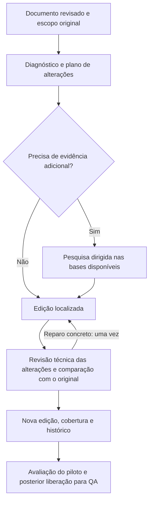

# Plano para uma nova edição dos 40 contextos

Estado: proposta para discussão; sem implementação ou alteração dos documentos.

## Objetivo e base

Melhorar os 40 documentos existentes por correção, complementação, aprofundamento
e edição. A entrada é a versão revisada em `relatorios/dez_areas_final_v2`, junto
da frase integral do especialista, recortes curados, proveniência e pendências
da pesquisa original. Preservar as correções de `revisao_especialista`.

Já existe uma pasta chamada `dez_areas_final_v2`. Para evitar sobrescrita ou
confusão, a nova edição poderá ser publicada em `dez_areas_final_v3`, com indicação
explícita de qual documento anterior originou cada versão.

Os pilotos novos de produtos químicos fornecem achados e fontes a avaliar, não um
texto substituto automático. A comparação mostrou que explicações importantes do
original, como bottle test, mecanismos de MEG, squeeze, parafinas, asfaltenos e
monitoramento de corrosão, podem se perder quando se redige tudo novamente.

## Critérios permanentes

- Preservar conteúdo útil, condições, exceções e distinções técnicas. Uma remoção
  ou fusão exige motivo e correspondência com o destino do conteúdo.
- Respeitar tópico, subtópico e frase do especialista. Novas fontes não redefinem
  o assunto nem criam capítulos apenas porque há material disponível.
- Português brasileiro e linguajar profissional do Brasil, explicando siglas e
  termos quando necessário. Contextualizar em FPSO quando pertinente.
- Documento autônomo, com conceitos, mecanismos, condições, critérios, interações
  e consequências. Fontes, IDs, lacunas e pareceres permanecem nos auxiliares.
- Fontes acadêmicas e profissionais se complementam: profundidade mecanística e
  experiência aplicada são avaliadas por pertinência e suporte, não por rótulo.
- Limites de fabricante, casos e recomendações estrangeiras permanecem delimitados.
  Não inventar números, dosagens, requisitos normativos ou resultados empíricos.
- Referência herdada não é automaticamente uma nova verificação. Registrar o que
  foi preservado, reconferido, corrigido e acrescentado.
- Qualidade do texto e cobertura do escopo são decisões separadas. Limite opcional
  não rejeita explicação correta; erro técnico e lacuna essencial exigem ação.

## Fluxo proposto

### 1. Inventário e proteção da edição anterior

Conferir os 40 documentos, suas assinaturas, frases de escopo, recortes e arquivos
auxiliares. Relacionar pendências existentes e correções motivadas pelo especialista.
Manter títulos/IDs estáveis quando possível e construir um mapa dos conteúdos já
presentes. Isso pode começar pelas estruturas JSON e pelos recortes curados, sem
replanejar os assuntos do zero a cada execução.

A edição anterior fica preservada. Os testes do mecanismo e as futuras edições
trabalham em saída própria, com retomada e histórico.

### 2. Diagnóstico do documento inteiro

Uma leitura orientada pela frase original identifica necessidades concretas:

| Necessidade | Ação |
|---|---|
| Erro, generalização ou condição ausente | Corrigir a afirmação e conferir suporte |
| Parte essencial do pedido ausente ou superficial | Pesquisar e completar esse ponto |
| Explicação pouco desenvolvida | Aprofundar causa, condição, critério ou consequência pertinente |
| Problema de texto ou organização | Editar, reorganizar ou fundir com preservação de conteúdo |
| Aprofundamento opcional | Registrar e priorizar por benefício; não bloquear por padrão |
| Conteúdo adequado | Preservar |

O diagnóstico devolve uma lista curta de intervenções, com localização, motivo,
prioridade e resultado esperado. Não obriga a encontrar defeitos em todos os
capítulos nem a completar todas as combinações de produto, equipamento e operação.

O mapa de cobertura conserva os mesmos pontos antes/depois. Não comparar uma
pontuação de 16 itens novos com outra de 20 itens antigos como se fossem a mesma
medida. Quando a frase enumera mecanismos distintos, sua cobertura deve continuar
identificável, mesmo se forem discutidos no mesmo capítulo.

### 3. Pesquisa dirigida e reaproveitamento do mecanismo anterior

Reaproveitar recortes curados, passagens originais, pesquisa por relações com
condições e limites, proveniência e contratos do mecanismo documental anterior.
Executar somente o que a intervenção exige. Evitar acionar o Runner completo para
regenerar e auditar todos os blocos já revisados.

Usar a recuperação local já disponível, com consultas específicas PT/EN e fusão
de resultados. Pesquisar as fontes antigas e as coleções profissionais instaladas,
incluindo as novas fontes de química quando pertinentes. Não substituir todo o
acervo por documentação comercial nem presumir que as fontes de química atendem
aos outros 39 assuntos.

Para cada necessidade, selecionar passagens que tragam informação útil: mecanismo,
condição, aplicação, critério, interação, exceção ou monitoramento. Verificar o
processo/equipamento, material, contexto operacional e jurisdição antes de usar.

Uma primeira pesquisa pode ser refinada uma vez se houver uma necessidade clara
e perspectiva de informação adicional. Sem evidência nova pertinente, registrar
a pendência e parar a pesquisa daquele ponto. Não repetir redação para disfarçar
a ausência de suporte.

Fontes legais, normativas e informações sujeitas a mudança precisam ser conferidas
em fontes primárias pertinentes quando houver intervenção nesses conteúdos.

### 4. Edição localizada com preservação de profundidade

O editor recebe o documento, o plano de alterações, as evidências selecionadas e
as correções do especialista. Pode acrescentar parágrafos, aprofundar explicações,
corrigir condições, ajustar títulos, reorganizar seções e remover redundâncias.
Entrega alterações localizadas e o documento consolidado.

Não há limite de palavras como objetivo editorial nem obrigação de alongar o
documento. Uma explicação maior pode ser necessária; uma síntese menor pode ser
melhor quando remove repetição. A avaliação considera a informação transmitida.

As alterações devem conservar conhecimento importante mesmo ao mudar a organização.
Um quadro auxiliar relaciona conteúdo anterior com conteúdo preservado, corrigido,
fundido ou removido. Condensação que perde mecanismo, condição ou exceção precisa
ser corrigida antes da publicação.

### 5. Revisão técnica e comparação antes/depois

Revisar em conjunto as partes alteradas, as fontes e suas interfaces com o restante
do documento. O revisor verifica:

- correção e suporte das afirmações novas ou modificadas;
- preservação das condições e correções anteriores;
- ausência de perda de profundidade útil;
- coerência, organização, redundâncias e autonomia do texto;
- atendimento dos pontos do escopo e relevância das pendências restantes;
- português brasileiro e clareza dos conceitos e termos.

Agrupar alterações relacionadas em vez de criar uma chamada de auditoria para cada
parágrafo. Usar uma rodada de correção dos defeitos apontados. Quando a alteração
não é aprovada, preservar a versão anterior somente se ela não contiver o próprio
erro identificado; caso contrário, sinalizar o problema explicitamente e impedir
que o conteúdo problemático alimente QA.

Além da revisão de alterações, conferir o documento consolidado para verificar
ligações entre seções, exceções omitidas e contradições. Isso integra a mesma etapa
de revisão; não exige criar outros agentes ou uma cadeia de auditorias.

### 6. Coerência entre os documentos relacionados

Depois da aprovação dos pilotos, conferir interfaces por área. Exemplo: produtos
químicos, água produzida, água de injeção e gás precisam usar conceitos e condições
compatíveis. Preservar autonomia de cada documento: repetição necessária para
compreensão não é duplicação a eliminar automaticamente.

Priorizar conceitos compartilhados, unidades, siglas, terminologia brasileira,
condições de segurança e orientações que poderiam entrar em conflito entre temas.
Não fazer comparação combinatória de todos os parágrafos dos 40 documentos.

## Relação com a futura geração de questões

O texto deve permitir explicar mecanismos, reconhecer consequências, distinguir
causas e justificar decisões/procedimentos sob condições explícitas. Isso favorece
as seis classes de questões já definidas, sem impor seis tipos a cada parágrafo.

Usar pareceres do especialista e falhas anteriores para identificar necessidades
de conhecimento. Separar falha documental de problema de redação ou avaliação da
questão. Não ampliar o contexto para acomodar uma pergunta malformulada.

Questões e gabaritos não entram nos prompts de escrita dos contextos. Quando um
parecer indicar lacuna real, converter a necessidade em objetivo técnico de pesquisa.
Exemplos antigos e datasets de QA ficam para os prompts de forma do futuro gerador,
com origem registrada; nenhum dataset externo de questões será baixado ou alterado.

Durante o piloto de polimento, QA permanece desligada. Depois de avaliar a edição,
uma execução separada usa a versão documental fixada e aprovada. Erros técnicos e
lacunas essenciais são tratados como impedimentos explícitos; limites opcionais
não são apresentados como falhas de todo o conteúdo.

## Entregas por documento

1. Documento técnico limpo em JSON e Markdown, mantendo compatibilidade com o
   consumidor existente quando viável; adaptar a integração separadamente se necessário.
2. Histórico antes/depois com motivo, localização e evidências da alteração.
3. Mapa de cobertura estável e lista priorizada de pendências.
4. Proveniência herdada e nova, complementos conceituais e parecer da revisão.
5. Resumo de chamadas/tokens, versão, hashes e motivo de parada.

Reaproveitar os formatos auxiliares existentes quando atendem a essas necessidades,
evitando multiplicar arquivos e sistemas de controle.

## Critérios de aceitação e parada

A nova edição precisa preservar o conhecimento útil do original, manter as
correções do especialista, sustentar alterações factuais, melhorar os pontos
priorizados e deixar claro o que não foi resolvido. Ganho de palavras, de fontes
citadas ou de questões potenciais, isoladamente, não demonstra melhora.

Parar quando as intervenções propostas forem avaliadas; não houver evidência nova
para a pendência restante; ou o orçamento do documento for atingido. Haverá uma
rodada inicial de edição e uma correção limitada. Orçamento e tamanho dos lotes de
alterações serão ajustados pelo piloto, sem reproduzir as centenas de chamadas
por documento da geração antiga.

O relatório distingue texto revisado, cobertura e elegibilidade para QA. A ausência
de evidência não vira preenchimento pelo modelo nem é ocultada por um status geral
de concluído.

## Implantação por etapas

1. **Piloto em 02_02 — Produtos químicos.** Usar o documento antigo revisado, seus
   57 blocos e as correções do especialista como base. Preservar bottle test,
   mecanismos de antiespumantes, MEG, squeeze, parafinas/asfaltenos e distinções de
   monitoramento. Incorporar os ganhos profissionais dos pilotos após conferência.
   Priorizar compatibilidade e interações críticas; corrigir, quando pertinente,
   generalizações sobre oxigênio/microbiologia, oxidantes/membranas e parâmetros de fabricante.
2. **Validar a comparação antes/depois.** Ler as alterações e verificar preservação,
   relevância, suporte e custo. Recalibrar o procedimento se a nova edição perder
   conhecimento ou pesquisar sem trazer benefício.
3. **Testar generalização.** Aplicar a 03_03 — Tanques/lastro/gás inerte e a
   07_01 — Instrumentação, controle e automação, com fontes pertinentes a esses
   assuntos. Verificar as correções anteriores do especialista e a adequação do
   mecanismo fora do tema de química.
4. **Expandir aos 40 em lotes por área.** Priorizar erros conhecidos, pendências
   essenciais e contextos associados a dificuldades já identificadas pelo especialista.
   Revisar interfaces antes da publicação da coleção.
5. **Avaliar a nova QA separadamente.** Comparar questões com origem e versão do
   contexto fixadas, examinando correção, autonomia, ambiguidade, diversidade e
   cobertura. Não assumir que o polimento aumentará automaticamente a quantidade
   ou a qualidade das questões.

Esta proposta preserva o mecanismo documental anterior onde ele acrescenta valor
e aproveita a pesquisa e a edição mais enxutas dos pilotos. A unidade de trabalho
passa a ser a melhoria necessária, em vez da regeneração integral do documento.
