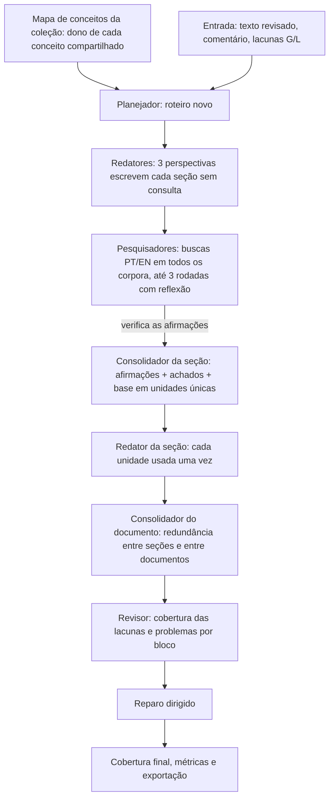

# Refino dos 40 contextos a partir da revisão do especialista

Fluxo novo, separado do polimento. Usa a revisão de Mazzuco (16/11/2026) como entrada
e reescreve cada documento com roteiro novo, juntando pesquisa nos corpora (deep
research) e conhecimento do próprio modelo. Não gera questões e não altera as versões
anteriores nem os datasets de QA.

## Por que um fluxo novo

O especialista mexeu pouco no texto (0,05% das palavras), mas listou 221 lacunas e
pediu revisão ou reconstrução de 14 documentos. Os problemas mais citados: falta de
estrutura (introdução, componentes, funções, sequência lógica), tratamento superficial,
repetição de conceitos e conteúdo fora do contexto FPSO ou casuístico. Edição localizada
não resolve estrutura, e ele mesmo usou LLM para levantar o que faltava. Métricas
completas em `Comentários especialista/metricas_feedback_especialista_20261116.md`.

## Agentes



1. **Mapa de conceitos** (uma chamada para os 40): para os conceitos que se repetem entre
   documentos, define o documento dono e o enfoque dos demais. Cada documento desenvolve
   o que é dele e só menciona o resto sob o seu ângulo.
2. **Planejador**: seção de introdução + sequência lógica. Cada lacuna do especialista vai
   para um objetivo de conhecimento (ou é justificada como de outro documento); cada bloco
   da base revisada vai para uma seção ou é descartado com motivo (casuístico, fora de
   FPSO, fora do escopo, redundante).
3. **Redatores** (`writers`): o mesmo modelo, três perspectivas (operação, engenharia,
   SMS/integridade), escrevem cada seção sem consulta, em afirmações atômicas.
4. **Pesquisadores**: buscam por seção em todos os corpora prontos (BM25 bilíngue, RRF
   entre índices, diversidade por coleção), leem as passagens, extraem achados e verificam
   as afirmações dos redatores (apoia/contradiz). Repetem com consultas novas para o que
   continua sem suporte, até `research_rounds`.
5. **Consolidador da seção**: funde afirmações equivalentes, achados e blocos revisados em
   unidades únicas. Uma afirmação entra em uma única unidade. Contradita só entra corrigida
   por achado. Conteúdo do modelo sem evidência entra como complemento; valor numérico sem
   achado nem bloco revisado é descartado (`allow_values_without_source=false`, conforme o
   AGENTS.md). Cada unidade recebe um estatuto calculado pelo código: `evidencia`,
   `base_revisada`, `consenso_modelos` (2+ perspectivas) ou `modelo`.
6. **Redator da seção**: escreve os blocos usando cada unidade exatamente uma vez. A
   introdução é escrita por último, já sabendo o que as outras seções contêm.
7. **Consolidador do documento**: recebe os pares de sentenças quase repetidas (dentro do
   documento e contra os documentos já refinados no lote) e remove a redundância sem perder
   informação.
8. **Revisor**: cobertura de cada lacuna (atendido/parcial/ausente) e problemas por bloco
   (erro técnico, fora de FPSO, casuístico, relato de fonte, terminologia, valor sem fonte,
   redundância, superficial, estrutura). Um reparo dirigido por seção.
9. **Cobertura final** com o mesmo prompt aplicado à base revisada, para comparar antes e
   depois com o mesmo critério.

Verificações locais em todos os textos: relato de fonte ("a fonte afirma", "o trecho") e os
termos que o especialista trocou (cabeçalho → header, linga → eslinga, padeye → olhal,
chaminé do flare → torre etc.) bloqueiam a resposta e voltam ao modelo para correção.

## Entradas

`entradas/XX_YY.json`, geradas por `preparar_entradas.py` a partir dos .docx revisados:
texto revisado sem o comentário final, sem os 5 trechos que ele mandou remover/descartar
e sem os comentários escritos no corpo; anotações dos trechos fora de FPSO e dos
realçados sem instrução; comentário literal, análise LLM anexada, lacunas `G..` (texto do
comentário) e `L..` (tabelas de LLM), nível de encaminhamento. Duas trocas automáticas
do 9.2 com erro evidente foram corrigidas (mais uma aspa desbalanceada) e ficam registradas em
`correcoes_automaticas`.

Para regenerar (na raiz, nesta máquina):

```bash
python -m pipeline.qa_research.refino.preparar_entradas \
  --docx "Comentários especialista/Documento de Contexto - revisão especialista 2026-11-16"
```

## No servidor

### 1. Ampliar os corpora (uma vez)

Os pesquisadores usam todos os manifestos prontos entre `dataset/domain_corpora`,
`dataset/professional_corpora_v3` e `dataset/professional_corpora_v2`. Para ampliar ao
máximo, instale a v3 com todas as coleções profissionais, inclusive as novas: NRs do MTE
(`mte_nr`), regulação de segurança operacional da ANP (`anp_regulacao`, inclusive a minuta
do novo SGSO em consulta pública), CONAMA 393/2007 (`conama`) e uma lista fechada de
verbetes técnicos da Wikipedia em inglês (`wikipedia_en`), além das já existentes. As normas
da Marinha ficaram de fora: o portal da DPC responde 403 à coleta automática.

```bash
git pull --ff-only origin codex/qa-evidencias-verificadas
export DOCUMENT_PYTHON="$PWD/.venv-documento/bin/python"
"$DOCUMENT_PYTHON" -m pip install -r pipeline/qa_research/v2/requirements.txt
bash pipeline/qa_research/instalar_corpus_profissional_v2.sh \
  --output dataset/professional_corpora_v3 \
  --max-documents 400 --max-pages 2000 --depth 2 --allow-errors
```

Sem `--sources`, o instalador coleta todas as coleções do catálogo. `--allow-errors` aceita
fontes que falharem (o relatório registra quais); `--retry-failed` tenta de novo só as URLs
com erro. O `domain_corpora` (Petrolês, ANP, HSE, BSEE, REGIS) continua como está.

### 2. Construir os índices de busca (uma vez, em paralelo)

```bash
"$DOCUMENT_PYTHON" -m pipeline.qa_research.refino.indexar --manifest auto
```

Constrói o índice BM25 de cada corpus pronto em `dataset/indices_refino`, com vários
processos preparando os trechos (os JSONL grandes, como o REGIS, são divididos em faixas
que respeitam a fronteira de documento) e um escritor com cache grande, sem journal, que
monta os índices secundários e o FTS5 de uma vez no fim. O banco é idêntico ao do
`CorpusIndex` (mesmo fingerprint, mesmas linhas e mesma busca; ver `tests/test_indexar.py`),
então o refino e os outros fluxos o reaproveitam. Mostra progresso e tempo restante.
`--workers` define os processos (padrão: o menor entre núcleos − 1 e RAM/4 GB, até 16) e
`--cache-mb` o cache do SQLite (padrão: RAM/8, até 2 GB). Os trechos são gerados em fluxo,
sem carregar a faixa inteira na memória. A cada minuto sem tarefa concluída, o terminal
mostra qual tarefa está sendo esperada e a memória livre. Uma execução interrompida deixa
arquivos `*.build.sqlite3` e `prep-*.pkl.gz`; a seguinte os apaga sozinha. Se a pasta do projeto estiver em disco de rede,
use `--index-cache` num disco local com espaço (o índice do `domain_corpora` ocupa
dezenas de GB) e passe o mesmo `--index-cache` ao refino. O refino também chama este
construtor sozinho se o índice não existir.

Antes de construir, o `indexar` procura em `pipeline/qa_research/.local/index` um índice
pronto de fluxos anteriores feito dos mesmos arquivos de dados, na mesma ordem e com a
mesma janela (350 palavras, passo 250). Se achar, move o banco para `dataset/indices_refino`
(mesmo disco, instantâneo), grava o fingerprint atual e não reconstrói. O conteúdo é o mesmo;
só o fingerprint mudou (a fórmula ganhou a chave "complete" em 31/10/2026). `--sem-adotar`
desliga essa busca e `--adotar-de` aponta outras pastas.

### 3. Conferir e rodar o piloto

```bash
"$DOCUMENT_PYTHON" -m pip install -r pipeline/qa_research/refino/requirements.txt
bash pipeline/qa_research/rodar_refino_contextos.sh --plan
nohup bash pipeline/qa_research/rodar_refino_contextos.sh \
  --output pipeline/qa_research/saida_refino/piloto_01 \
  > refino_piloto_01.log 2>&1 &
tail -F refino_piloto_01.log
```

O piloto padrão é 2.6 (reconstrução pedida), 2.8 (revisão pedida) e 9.1 (bem avaliado,
controle). `--plan` mostra os manifestos encontrados, as entradas e a estimativa de
chamadas, sem chamar modelos. O índice BM25 de cada manifesto fica em cache em
`dataset/indices_refino` (a primeira construção do `domain_corpora`, com REGIS, demora).
Para outros documentos: `--items 02_02 03_03` ou `--items all`.
Para manter os mesmos donos de conceito entre execuções:
`--mapa pipeline/qa_research/saida_refino/piloto_01/mapa_conceitos.json`.

Modelo: `gpt-5-4-petrobras` em todos os papéis (esforço em `config_piloto.json`). `--workers N` muda o
número de chamadas simultâneas ao modelo (padrão 3). O teto é
de 180 tentativas por documento (`--max-calls`), cumulativo com as retomadas. Repetir o
comando retoma: chamadas com a mesma entrada vêm do cache.

### 4. Coletar e devolver

O terminal mostra "O código acabou de rodar no terminal 🙂" e os comandos. Padrão:

```bash
"$DOCUMENT_PYTHON" -m pipeline.qa_research.refino \
  --output pipeline/qa_research/saida_refino/piloto_01 \
  --collect pipeline/qa_research/relatorios/refino_contextos_piloto_01
git add -- pipeline/qa_research/relatorios/refino_contextos_piloto_01
git commit -m "Resultados do piloto de refino dos contextos"
git push origin codex/qa-evidencias-verificadas
```

A coleta exclui `.local/` (cache, respostas brutas, embeddings) e não leva texto original
dos corpora: `proveniencia.json` guarda só metadados das passagens.

## Polimento de estilo e limpeza

Depois da revisão, um editor de estilo percorre o documento capítulo a capítulo, em ordem, levando
adiante as siglas já apresentadas: expande cada sigla na primeira ocorrência, tira o texto que fala
do próprio documento ("esta seção", "Estrutura do documento", "ver Seção 4") e os travessões, sem
mudar o conteúdo técnico (o contrato recusa números novos e cortes acima de 20%). `polimento.json`
guarda as alterações e o relatório traz a contagem antes e depois. A cobertura das lacunas só conta
"atendido" quando o item é explicado; menção de passagem conta como parcial.

Ao concluir um documento, o cache `.local` (respostas brutas, chamadas e embeddings) é apagado; só
os vetores finais ficam em `vetores_semanticos.npz` (float16) para a medida entre documentos.
`--manter-local` desliga a limpeza. Documento já concluído na mesma saída não é refeito. Na coleta,
`--apagar-saida` remove a pasta de saída depois de copiar os resultados (só lote concluído).

## Texto pronto para ser recortado em questões

Os documentos serão recortados de várias formas para gerar questões. A solução tem duas camadas:

1. No texto: cada bloco se sustenta sozinho (sujeito nomeado, sem "esse sistema" apontando para outro
   bloco), siglas expandidas na primeira ocorrência de cada capítulo, um termo por conceito e
   afirmações verificáveis (definição, função, causa, condição, contraste, sequência). Redator,
   revisor (problema "vago") e editor final cobram isso.
2. Fora do texto: `blocos_questoes.jsonl` (um bloco por linha, com documento, capítulo, subtítulo,
   siglas do bloco já expandidas, unidades de conteúdo e se o bloco tem conteúdo sem evidência) e
   `glossario.json`. Para qualquer recorte, `para_questoes.contexto(trecho, blocos, glossario)`
   devolve um cabeçalho com documento, seção e as siglas do trecho, para pôr à frente dele na
   geração e na resposta das questões (o texto do trecho não muda).

O relatório mede a fração de sentenças com relação verificável e a de prosa vaga (heurística, para
comparar versões). No 1.1: 38% → 49% de sentenças verificáveis.

## Saídas por documento

- `documento.md` / `documento.json`: nova versão, no formato da v2 (consumível pela QA).
- `documento_base.md`: base revisada pelo especialista, sem os trechos removidos.
- `roteiro.json`, `rascunhos.json`, `pesquisa.json`, `consolidacao_secoes.json`,
  `proveniencia.json` (estatuto e fontes de cada unidade), `consolidacao_documento.json`,
  `revisao.json` (problemas e reparos), `cobertura_base.json`, `cobertura_final.json`.
- `metricas.json` e `RELATORIO.md`: antes e depois (palavras, blocos, redundância lexical e
  semântica, cobertura das lacunas), origem do conteúdo, fusão das afirmações, descartes por
  motivo, pesquisa por coleção, problemas da revisão, chamadas.
- No lote: `RELATORIO.md`, `resumo_lote.json` (inclui redundância entre documentos antes e
  depois) e `mapa_conceitos.json`.

## Testes offline

```bash
python -m unittest pipeline.qa_research.refino.tests.test_refino -v
```

Modelo simulado e corpus mínimo: contratos, verificações locais, fluxo completo, retomada
sem chamadas novas e coleta sem `.local`.
